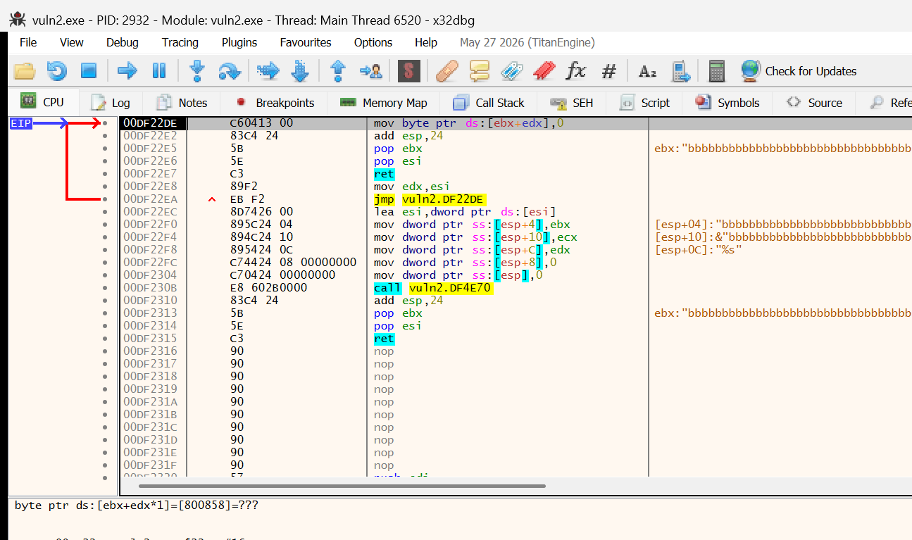
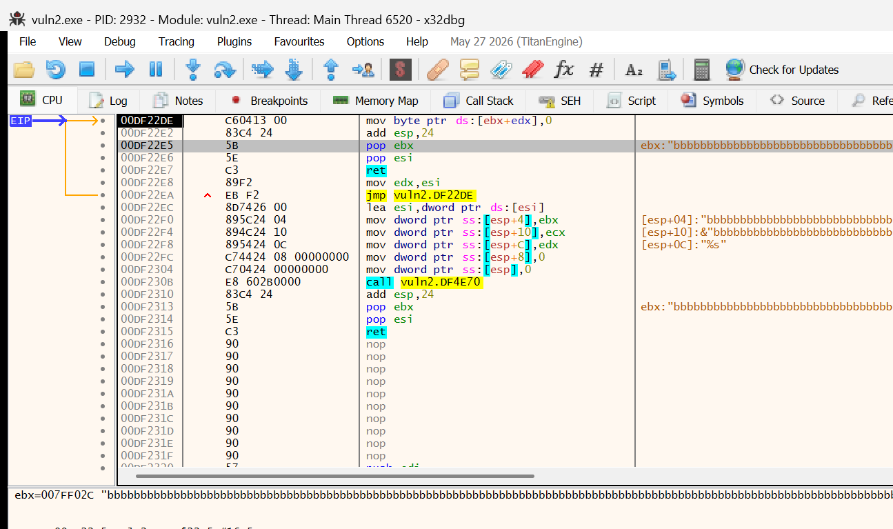

# Лабораторная работа № 1

**Тема:** изучение принципов поиска уязвимостей в программном обеспечении без исходных кодов
**Вариант:** 2 (`vuln2.exe`, `config_2`, `func.dll`)
**ТЗ:** `lab1/Лабораторная_работа_1_Поиск_уязвимостей_без_исходных_кодов.docx`

> Черновик отчёта в Markdown. Скриншоты — в `lab1/report/img/`, полные листинги — в
> `lab1/fuzzer.py` и `lab1/ida/find_calls.py` (в финальный docx выносятся приложениями).

---

## 1. Цель работы

Изучить типовые ошибки программного обеспечения (отсутствие проверки длины копируемых
данных, целочисленные переполнения, переполнение буфера) и освоить методы поиска таких
ошибок при отсутствии исходного кода: мутационный фаззинг формата файла, измерение
покрытия кода средствами динамической бинарной инструментации, фаззинг с обратной связью
по покрытию, анализ найденной уязвимости в дизассемблере и отладчике.

## 2. Исходные данные

| Файл | Размер | SHA-256 (начало) | Назначение |
|---|---|---|---|
| `vuln2.exe` | 45 056 байт | `3854367C72EC7F60…` | исследуемая программа (32-битная) |
| `config_2` | 1 123 байта | `3D16CFA508F3516E…` | корректный конфигурационный файл варианта 2 |
| `func.dll` | 10 240 байт | `70CCB19FFBF4B536…` | вспомогательная библиотека (функция `Func1`) |

Защиты цели (из заголовка PE): разрядность 32 бита, `DllCharacteristics = 0x0040` —
**DEP (NX) включён, ASLR (DYNAMIC_BASE) выключен**, CFG отсутствует.
Образ при загрузке смещается относительно предпочтительной базы `0x00400000`
(в проведённых запусках — `0x00DF0000`), поэтому все адреса в отладчике считаются
от фактической базы (`lpBaseOfImage`).

Вывод цели на корректном конфиге:

```
VERSION: 0.3
Variant: 2
Called Hello function from dll
read config:  shell_len 1075  dst_len 2500
buffer: vbzyqgdemwocajesnnuwqhbxtstltmyajhxalgzucstugatmiidkleglhuvaektwknnd…
```

Цель **не принимает путь в аргументах**: имя `config_2` формируется внутри программы
(`sprintf(Buffer, "config_%d", 2)`), файл открывается в текущем каталоге, а номер
варианта из первого байта файла сверяется с зашитым в бинарник (`cmp al, 2`).

## 3. Формат конфигурационного файла

Формат восстановлен по дизассемблеру (`read_config`) и подтверждён экспериментами.

| Смещение | Размер | В `config_2` | Смысл |
|---|---|---|---|
| 0 | 1 | `02` | номер варианта; при несовпадении — `ERROR: variant does not match`, `exit(-1)` |
| 1–3 | 3 | `00 00 00` | выравнивание |
| 4 | 4 | 1075 | `shell_len`; печатается, передаётся в `vuln_func`, **в копировании не участвует** |
| 8 | 4 | 2500 | `dst_len`; печатается и **используется как размер приёмного буфера** |
| 12–15 | 4 | 0 | не используется |
| 16 | 2 | 1075 | младшее слово `shell_len` |
| 18 | 2 | 2500 | младшее слово `dst_len` |
| 20–47 | — | — | прочие поля шапки, на вывод не влияют |
| 48 | 6 | `/start` | маркер начала данных; от него `parse_string` отсчитывает нагрузку |
| 54–1121 | 1068 | буквы | полезная нагрузка |
| 1122 | 1 | `00` | **нулевой байт-терминатор в конце файла** |

Два важных следствия, проверенных экспериментально:

* копируется строка **начиная с байта 54** (сразу за `/start`) и до нулевого байта —
  поэтому **допись в конец файла не попадает в копирование** (её отсекает `00` в конце
  исходного файла);
* длина копирования ограничивается значением `dst_len` из шапки — то есть **из файла**.

## 4. Разработанный фаззер

`lab1/fuzzer.py` — один файл на Python 3.12, только стандартная библиотека.
Запуск: `py -3.12 lab1/fuzzer.py` (открывается меню) либо с флагами
(`--seq1`, `--seq2`, `--cov`, `--cov-fixed boundary`, `--mutate byte`, `--run`, `--stats`).

Меню:

```
 1  SEQ-1: последовательная замена байт граничными значениями (ТЗ, авторежим)
 2  SEQ-2: удлинённый файл (вставка за /start) x поля шапки   <- находит краш
 3  COV:   покрытие DynamoRIO + смена стратегий по покрытию   <- доп. задание
 4  COV-контроль: то же, но стратегия зафиксирована (для сравнения)
 5  замена одного байта (вручную)          6  замена нескольких байт (вручную)
 7  дописать в конец / расширить (вручную) 8  найти разделители ,:=; и мутировать
 9  один запуск work/config_2 (регистры и стек при падении)
10  статистика: журналы, краши, корпус
```

### 4.1. Реализованные методы фаззинга (требования ТЗ)

| Метод | Функция | Что делает |
|---|---|---|
| однобайтовая замена | `mut_byte` | замена одного байта (0x00, 0xFF, 0x7F, 0x80, случайный) |
| замена нескольких байт | `mut_multi` | 2–8 байт за прогон |
| граничные значения | `mut_boundary` | `00, 01, 7F, 80, FF, FFFF, 7FFF, 8000, 8001, FFFE, FFFFFF, 7FFFFF, 800000, FFFFFFFF, 7FFFFFFF, 80000000, FFFFFFFE, 7FFFFFFE, 0000FFFF, 00000000` |
| граничные значения в полях шапки | `mut_field` | прицельно по 4-байтным полям 4…44 |
| допись в файл | `mut_append` | +64…5120 байт в конец |
| расширение значений полей | `mut_expand` | вставка внутрь файла (в т.ч. сразу за `/start`) |
| разделители полей | `mut_delim` | поиск `,:=;`, размножение разделителя, вставка длинного значения |
| длинный вход (ключевой) | `mut_inject` | вставка 3000–16384 байт за `/start` + завышение поля длины |

Байт 0 (номер варианта) не мутируется никогда — иначе цель завершается с `exit(-1)`.

### 4.2. Автоматический режим последовательной замены (SEQ-1)

Перебираются все смещения файла (кроме первого) и все граничные значения подходящей
ширины: **1122 смещения × 21 значение = 23 529 прогонов**, ~82 прогона/с (4,8 мин).
Журнал — `lab1/logs/seq.log` (номер прогона, проход, статус, код возврата, мутация,
размер файла). Результат: **0 крашей** — одиночная замена байта не создаёт условий
переполнения (см. §7.4).

### 4.3. Проход по удлинённому файлу (SEQ-2)

Файл с вставкой 5120 байт сразу за маркером `/start` × граничные значения в 4-байтных
полях шапки. Первый же прогон (поле по смещению 8 = `0xFFFFFFFF`) даёт падение —
именно этот вход сохранён как краш-конфиг фаззера.

### 4.4. Обнаружение ошибки, код ошибки, стек и регистры

Крашем считается код возврата `0xC000xxxx` (исключение Windows); штатный `exit(-1)`
при несовпадении варианта крашем не считается. После обнаружения краха вход
прогоняется повторно под мини-отладчиком, написанным на `ctypes`
(`CreateProcessW` с `DEBUG_ONLY_THIS_PROCESS`, `WaitForDebugEvent`,
`Wow64GetThreadContext` для 32-битного контекста WOW64, `ReadProcessMemory` для стека).
Снимаются: код исключения, `EAX…EFLAGS`, дамп стека, адрес и значение сохранённого
адреса возврата (`[EBP+4]`), база образа. Всё это вместе со списком произведённых замен
пишется в `lab1/crashes/crash_<дата>.txt`, сам вход — в `crash_<дата>.bin`
(требование ТЗ о логировании ошибки вместе с входными параметрами).

### 4.5. Логирование

| Файл | Содержимое |
|---|---|
| `logs/seq.log` | прогон, проход, статус, код, мутация, размер файла |
| `logs/cov.log` | то же + `BB_run` / `BB_parent` / `BB_global` |
| `logs/adapt.log` | смены стратегий: `run, from→to, reason, BB_run, BB_parent, BB_global` |
| `crashes/*.txt` | код исключения, регистры, стек, список замен |

## 5. Измерение покрытия (DynamoRIO)

Покрытие измеряется средством динамической бинарной инструментации **DynamoRIO 11.3.0**
(режим `drcov`), как того требует ТЗ (допускается Intel Pin или DynamoRIO):

```
drrun -t drcov -logdir <каталог> -- work\vuln2.exe        (cwd = lab1\work)
```

Лог `drcov.*.log` содержит таблицу модулей и **бинарную** таблицу базовых блоков
(`BB Table: N bbs`, запись 8 байт: `uint32 start`, `uint16 size`, `uint16 mod_id`,
`start` — смещение от базы модуля). Фаззер разбирает её и учитывает только базовые
блоки цели (`vuln2.exe`) и `func.dll`.

Базовое покрытие оригинального `config_2`: **499 базовых блоков**
(447–448 в `vuln2.exe` + 51 в `func.dll`).

## 6. Режим с обратной связью по покрытию

Очередь сидов: если мутант выполняет базовые блоки, которых не было ни в одном
предыдущем прогоне (`gain`), он сохраняется в `lab1/corpus/` и становится родителем
для дальнейших мутаций — это и есть требуемое ТЗ «сохранение изменённых байт с учётом
их влияния на покрытие кода программы». Родитель выбирается случайно из набора
«оригинал + сиды»; покрытие каждого сида запоминается и используется как база сравнения.

## 7. Дополнительное задание: изменение алгоритма фаззинга по результатам покрытия

### 7.1. Постановка и выбор метрики

Требование: *«если фаззер видит, что покрытие становится меньше, он меняет алгоритм
своей работы для увеличения покрытия; алгоритм придумать самим и описать в отчёте»*.

Глобальное покрытие (объединение базовых блоков по всем прогонам) **монотонно растёт**
и уменьшиться не может, поэтому буквальная трактовка невыполнима. В работе
«уменьшение покрытия» измеряется двумя наблюдаемыми величинами:

1. **покрытие отдельного прогона против родителя**: `BB_run < BB_parent` — маршрут
   нового входа короче маршрута файла-родителя (мутация разрушила разбор конфига,
   цель вышла раньше). Сигнал `shrink`.
2. **прирост покрытия**: 30 прогонов подряд не дали ни одного нового базового блока —
   покрытие растёт всё меньше. Сигнал `plateau`.

### 7.2. Алгоритм

Активна ровно одна из четырёх стратегий мутирования; порядок обхода —
`byte → boundary → append → inject` по кругу.

```
shrink = 0        # сколько раз ПОДРЯД маршрут короче родителя
since_gain = 0    # сколько прогонов ПОДРЯД без нового покрытия

каждый прогон:
    BB_run, BB_parent, новые_BB = прогон_под_drcov()
    если новые_BB:                      # покрытие выросло
        since_gain = 0; shrink = 0
        сохранить вход в corpus/ как будущего родителя
    иначе:
        since_gain += 1
    shrink = shrink + 1 if BB_run < BB_parent else 0

    если shrink >= 3 или since_gain >= 30:      # ← вся адаптация
        стратегия = следующая по кругу
        shrink = 0; since_gain = 0
        запись в adapt.log(run, from→to, reason, BB_run, BB_parent, BB_global)
```

Стратегии: `byte` (один байт), `boundary` (граничные значения), `append` (допись),
`inject` (вставка длинных данных за `/start` + завышение поля длины).
Пороги 3 и 30 — «терпение» планировщика: 3 отсекает случайные короткие маршруты,
30 даёт стратегии честный шанс, но не позволяет залипнуть.

### 7.3. Результаты

Прогон с адаптацией (`--cov --max-runs 600`) и контрольный прогон с **зафиксированной**
стратегией `boundary` (`--cov-fixed boundary --max-runs 600`) на одном и том же
базовом покрытии:

| Показатель | С адаптацией | Фиксированная стратегия |
|---|---|---|
| Прогонов | 600 | 600 |
| Покрытие на старте | 499 BB | 499 BB |
| Итоговое покрытие | **509 BB** | 501 BB |
| События `gain` | +9 BB (прогон 91), +1 BB (прогон 147) | +1 BB (169), +1 BB (512) |
| Смен стратегии | **22** | 0 |
| Сидов в корпусе | 2 | 2 |
| Крашей найдено | **191** | **0** |

Фрагмент `lab1/logs/adapt.log` (полностью — 22 строки):

```
# 2026-09-11 21:21:37 | режим: адаптация по покрытию | BB оригинала: 499
run	from	to	reason	bb_run	bb_parent	bb_global
30	byte	boundary	plateau	499	499	499
60	boundary	append	plateau	499	499	499
90	append	inject	plateau	499	499	499      <- переключение на «inject»
106	inject	byte	shrink	424	499	508          <- покрытие прогона упало: 424 < 499
136	byte	boundary	plateau	499	499	508
177	boundary	append	plateau	497	497	509
211	inject	byte	shrink	422	497	509
…
576	boundary	append	plateau	497	497	509
```

В журнале видны оба типа сигналов: `plateau` (покрытие перестало расти) и `shrink`
(покрытие конкретного прогона меньше покрытия родителя). Сразу после третьего
переключения, когда планировщик дошёл до стратегии `inject`, произошёл `GAIN +9 BB`
(499 → 508) и было найдено падение цели:

```
[adapt] run 90: append -> inject (plateau) BB 499/499/499
[crash] 0xC0000005 strategy=inject -> crashes/crash_20260911_212152.bin
[cov] #91 GAIN +9 BB  всего=508  стратегия=inject  родитель=orig  seeds=1
```

Вывод: смена алгоритма по результатам покрытия увеличила покрытие на 10 базовых блоков
против 2 у фиксированной стратегии и позволила найти уязвимость, до которой
однообразные мутации не доходили.

## 8. Найденная уязвимость

### 8.1. Цепочка вызовов (по дизассемблеру IDA)

```
_main (0x401447)
 ├─ sprintf(Buffer, "config_%d", 2)                          [0x40154E]
 ├─ read_config("config_2", &cfg(0x40DA20), &data)            [0x40156D]
 │   ├─ fopen(FileName, "rb")                                 [0x401604]
 │   ├─ fseek/ftell -> ElementCount = размер файла            [0x401647/0x401652]
 │   ├─ malloc(ElementCount + 1)                              [0x40167E]
 │   ├─ fread(Buffer, 1, ElementCount, Stream)                [0x4016A2]
 │   ├─ Buffer[ElementCount] = 0
 │   ├─ memcpy(&cfg, Buffer, 0x30)   — 48 байт шапки в cfg    [0x4016CF]
 │   └─ *(arg_8) = Buffer + 0x30     — указатель на данные    [0x4016DD]
 └─ parse_string(data)                                        [0x40157C]
     ├─ strstr(Str, "/start")                                 [0x4013F4]
     ├─ найден  -> parse_string(p + strlen("/start"))         [0x40143B]  (рекурсия)
     └─ не найден -> vuln_func(Str, cfg.shell_len, cfg.dst_len) [0x40141B]
         ├─ char buf[2500]; memset(buf, 'b', 2500)            [0x4015AF]
         ├─ __mingw_snprintf(buf, dst_len, "%s", src)         [0x4015D3]
         │      -> sub_402270 -> sub_4022A0 (__mingw_vsnprintf)
         └─ printf("buffer: %s\n", buf)                        [0x4015E9]
```

### 8.2. Участок кода с уязвимостью

`vuln_func` — здесь объявлен буфер и вызывается форматирование с длиной из файла:

```asm
; --- vuln_func (0x40158D) ---
0x0040158D  push    ebp
0x0040158E  mov     ebp, esp
0x00401590  sub     esp, 9E8h              ; кадр функции
0x00401596  mov     [esp+8], 9C4h          ; Size = 2500 (0x9C4) — РАЗМЕР БУФЕРА
0x0040159E  mov     [esp+4], 62h           ; Val  = 'b'
0x004015A6  lea     eax, [ebp+var_9CC]     ; АДРЕС БУФЕРА = EBP-0x9CC
0x004015AC  mov     [esp], eax
0x004015AF  call    memset                 ; buf[2500] = 'b' * 2500
0x004015B4  mov     eax, [ebp+arg_8]       ; eax = dst_len  (из файла!)
0x004015B7  mov     edx, [ebp+arg_0]       ; edx = src (данные после /start)
0x004015BA  mov     [esp+0Ch], edx         ; 4-й аргумент = src
0x004015BE  mov     [esp+8], offset aS      ; 3-й = "%s"
0x004015C6  mov     [esp+4], eax           ; 2-й = dst_len  <- НЕ ПРОВЕРЯЕТСЯ
0x004015CA  lea     eax, [ebp+var_9CC]
0x004015D0  mov     [esp], eax             ; 1-й = buf
0x004015D3  call    sub_402270             ; snprintf(buf, dst_len, "%s", src)
0x004015D8  lea     eax, [ebp+var_9CC]
0x004015DE  mov     [esp+4], eax
0x004015E2  mov     [esp], offset aBufferS  ; "buffer: %s\n"
0x004015E9  call    printf
0x004015EE  leave
0x004015EF  retn
```

Место падения — внутри `sub_4022A0` (реализация `__mingw_vsnprintf`), на записи
нулевого терминатора:

```asm
; --- sub_4022A0 (0x4022A0), сокращённо ---
0x004022A5  mov     eax, [esp+2Ch+arg_4]   ; eax = n = dst_len (из файла)
0x004022A9  mov     ebx, [esp+2Ch+arg_0]   ; ebx = s = buf (2500 байт)
0x004022B5  test    eax, eax
0x004022B7  jz      short loc_4022F0
0x004022B9  lea     esi, [eax-1]           ; esi = n-1 = предел записи
0x004022D3  call    sub_404E70             ; форматирование строки
0x004022D8  cmp     eax, esi
0x004022DA  mov     edx, eax
0x004022DC  ja      short loc_4022E8       ; если длина > n-1 -> edx = n-1
0x004022DE  mov     byte ptr [ebx+edx], 0  ; <== ПАДЕНИЕ: запись за буфером
0x004022E2  add     esp, 24h
```

При `dst_len = 0xFFFFFFFF` предел записи становится `0xFFFFFFFE`, то есть ограничение
фактически отключается: форматирование записывает в 2500-байтовый буфер всю строку
(6188 байт), а терминатор пишется по адресу за пределами отображённой памяти.

### 8.3. Восстановленный исходный код участка (язык C)

```c
/* Глобальная структура с шапкой конфига (0x0040DA20) */
struct config {
    unsigned char variant;      /* +0  — номер варианта (сверяется с 2) */
    unsigned char pad[3];
    int  shell_len;             /* +4  — из файла (смещение 4) */
    int  dst_len;               /* +8  — из файла (смещение 8) */
    /* ... остальные поля шапки, 48 байт ... */
};
static struct config cfg;

/* Чтение конфига: файл читается целиком, шапка копируется в cfg,
   указатель на данные за шапкой возвращается через out */
int read_config(const char *FileName, struct config *cfg, char **out)
{
    FILE *Stream = fopen(FileName, "rb");
    if (!Stream) { printf("Error: couldn`t open config file '%s'\n", FileName); exit(-1); }

    fseek(Stream, 0, SEEK_END);
    long ElementCount = ftell(Stream);          /* размер файла */
    fseek(Stream, 0, SEEK_SET);

    char *Buffer = malloc(ElementCount + 1);
    fread(Buffer, 1, ElementCount, Stream);
    Buffer[ElementCount] = '\0';

    if (ElementCount > 0x2F)
        memcpy(cfg, Buffer, 0x30);              /* 48 байт шапки */
    *out = Buffer + 0x30;                       /* данные, начиная с "/start" */
    printf("read config:  shell_len %d  dst_len %d", cfg->shell_len, cfg->dst_len);
    ...
}

/* Рекурсивный поиск маркера: данные копируются ровно из позиции за "/start" */
int parse_string(char *Str)
{
    char *p = strstr(Str, "/start");
    if (p == NULL) {
        vuln_func(Str, cfg.shell_len, cfg.dst_len);   /* длины — из файла! */
        return 1;
    }
    parse_string(p + strlen("/start"));
    return 0;
}

/* УЯЗВИМЫЙ УЧАСТОК */
void vuln_func(char *src, int shell_len, int dst_len)
{
    char buf[2500];                      /* 0x9C4, адрес = EBP-0x9CC */
    memset(buf, 'b', sizeof(buf));

    snprintf(buf, dst_len, "%s", src);   /* ОШИБКА: dst_len не проверяется
                                            против sizeof(buf); при
                                            dst_len = 0xFFFFFFFF ограничение
                                            отключается и строка любой длины
                                            копируется в buf */
    printf("buffer: %s\n", buf);
}
```

### 8.4. Тип ошибки, причина, ограничения эксплуатации

* **Тип:** отсутствие проверки длины копируемых данных — переполнение буфера в стеке
  (CWE-120 / CWE-787), значение длины берётся из недоверенного файла.
* **Причина:** размер приёмного буфера для `snprintf` (`dst_len`) читается из
  конфигурационного файла и нигде не сверяется с фактическим размером буфера (2500).
  При `dst_len > 2500` запись выходит за пределы буфера, при `dst_len = 0xFFFFFFFF`
  ограничение снимается полностью.
* **Ограничения эксплуатации:**
  * данные должны находиться **сразу за маркером `/start`**: копирование начинается
    с байта 54, а исходный файл заканчивается нулевым байтом, поэтому допись в конец
    файла в копирование не попадает;
  * необходимо завышенное поле `dst_len` (смещение 8); поле `shell_len` (смещение 4)
    на копирование не влияет;
  * падение **вероятностное**: чем больше перезаписано за буфером, тем стабильнее
    (при 6188 байтах — 8/10 нативных запусков, эталонный конфиг — 9/10). При небольшом
    превышении (`dst_len` = 2501…3000) запись может остаться в пределах отображённого
    стека и цель не упадёт;
  * DEP включён, но ASLR **выключен** у образа, поэтому адрес возврата в переполнении
    предсказуем — это важно для следующей лабораторной работы (эксплуатация).

### 8.5. Формат файла, приводящего к краху

| Смещение | Размер | Значение | Комментарий |
|---|---|---|---|
| 0 | 1 | `02` | вариант — не менять |
| 4 | 4 | любое (например `0xFFFFFFFF`) | `shell_len`, на крах не влияет |
| **8** | **4** | **`0xFFFFFFFF`** | **`dst_len` — ключевое поле: снимает ограничение копирования** |
| 48 | 6 | `/start` | маркер |
| 54 | 5120 | `62 62 …` (`'b'`) | вставленные данные: буфер 2500 байт переполняется |
| 5174 | 1 | `00` | терминатор (в исходном файле он был на смещении 1122) |

Итоговый размер — 6243 байта. Артефакт: `lab1/crashes/crash_20260911_212711.bin`
(найден фаззером, режим SEQ-2, первый прогон) и лог `crash_20260911_212711.txt`.

### 8.6. Размер буфера, адрес буфера, адрес сохранённого адреса возврата

| Величина | Значение (по дизассемблеру) | Значение в прогоне |
|---|---|---|
| Размер приёмного буфера | `0x9C4` = **2500 байт** (аргумент `memset`) | — |
| Адрес начала буфера | `EBP - 0x9CC` | `0x00CEEB8C` (EBP = `0x00CEF558`) |
| Адрес сохранённого адреса возврата | `EBP + 4` | `0x00CEF55C` |
| Значение сохранённого адреса возврата | `0x401420` (в `parse_string`, сразу после `call vuln_func`) | `0x00DF1420` при базе `0x00DF0000` |
| Расстояние от начала буфера до saved EIP | `0x9D0` = **2512 байт** | — |
| Фактически скопировано | 6188 байт (`EAX = EDX = 0x182C` = 5120 + 1068) | — |
| Записано за буфер | 6188 − 2500 = **3688 байт** | — |

Регистры и стек на момент падения (из `crash_20260911_212711.txt`, мини-отладчик фаззера):

```
exception: 0xC0000005 (ACCESS_VIOLATION)   image_base: 0x00DF0000
EAX=0x0000182C  EDX=0x0000182C   <- длина строки 6188
EBX=0x00CEEB8C                   <- адрес буфера (EBP-0x9CC)
ESI=0xFFFFFFFE                   <- n-1, где n = dst_len = 0xFFFFFFFF
EBP=0x00CEF558  ESP=0x00CEEB20
EIP=0x00DF22DE                   <- base+0x22DE: mov byte ptr [ebx+edx], 0
saved_eip_addr=0x00CEF55C  saved_eip_value=0x00DF1420
stack:
  +00  00 00 00 00 8C EB CE 00 FE FF FF FF 42 A1 DF 00
  +10  7C EB CE 00 58 EB CE 00 CB 55 52 77 60 02 3F 01
  …
  +60  FE FF FF FF 90 8E 3F 01 63 01 0C 50 62 62 62 62
  +70  62 62 62 62 62 62 62 62 62 62 62 62 62 62 62 62
```




Скриншоты x32dbg подтверждают: `EIP = 0x00DF22DE` — инструкция
`mov byte ptr ds:[ebx+edx], 0`; в строке состояния — `ebx=007FF02C "bbbb…"` (адрес
буфера с данными переполнения), рядом видны аргументы форматирования `"%s"` и строка
из `'b'`.

### 8.7. Эксперименты, подтверждающие механизм

| Модификация конфига | Результат |
|---|---|
| оригинал | нет краха, печатается 1068 символов |
| +5120 байт **в конец файла**, `dst_len` без изменений | нет краха, 1068 символов |
| +5120 байт в конец, `dst_len = 0xFFFFFFFF` | нет краха, 1068 символов (данные отсекает `00` в конце исходного файла) |
| вставка 5120 байт **за `/start`**, `dst_len = 10` | нет краха, печатается 9 символов (обрезка по `dst_len-1`) |
| вставка 5120, `dst_len = 2500` | нет краха, 2499 символов |
| вставка 5120, `dst_len = 2501` / `2502` | нет краха, 2500 / 2501 символ (переполнение на 1–2 байта без последствий) |
| вставка 5120, `dst_len = 3000` | **крах 0xC0000005** |
| вставка 5120, `dst_len = 0x7FFFFFFF` | **крах 0xC0000005** |
| вставка 5120, `shell_len = 0xFFFFFFFF` (только смещение 4) | нет краха (на копирование не влияет) |
| вставка 4000 / 5120, `dst_len = 0xFFFFFFFF` | **крах 0xC0000005** |

Отсюда однозначно: переполнение определяется парой «данные за маркером» +
«завышенное поле `dst_len` (смещение 8)».

## 9. IDC/IDAPython-скрипт

`lab1/ida/find_calls.py` (IDAPython 3, IDA 7.7) обходит таблицу импортов точными
именами из белых списков (ввод: `fread`, `fscanf`, `sscanf`, `read`, `fgets`, `gets`,
`fopen`…; небезопасные: `strcpy`, `strcat`, `sprintf`, `strncpy`, `memcpy`, `memmove`,
`wcscpy`, `lstrcpyA/W`, `wsprintfA/W`), находит заглушки импортов (`jmp ds:__imp_*`)
и печатает **имя функции и адрес, откуда она вызывается**, в консоль IDA и в файл
`lab1/ida/calls.txt`.

Запуск в batch-режиме:

```
set MBKS_IDA_BATCH=1
idat64.exe -A -L<лог> -S<полный путь>\lab1\ida\find_calls.py <полный путь>\lab1\work\vuln2.exe
```

Результат для `vuln2.exe` (`lab1/ida/calls.txt`):

```
[input]  fopen  (import 0x0040F240, raw fopen)
  call 0x00401604  in read_config (0x004015F0)
[input]  fread  (import 0x0040F248, raw fread)
  call 0x004016A2  in read_config (0x004015F0)
[unsafe]  memcpy  (import 0x0040F270, raw memcpy)
  call 0x004016CF  in read_config (0x004015F0)     <- уязвимое копирование
  call 0x00401FB4  in sub_401F70 (0x00401F70)
  call 0x00401FFE  in sub_401F70 (0x00401F70)
  call 0x004029A8  in sub_402970 (0x00402970)
  call 0x00402B29  in sub_402970 (0x00402970)
  call 0x00402D1A  in sub_402970 (0x00402970)
  call 0x00403689  in sub_403590 (0x00403590)
  call 0x0040706D  in sub_405E60 (0x00405E60)
  call 0x00407A33  in sub_407970 (0x00407970)
[unsafe]  sprintf  (import 0x0040F28C, raw sprintf)
  call 0x0040154E  in _main (0x00401447)

imports matched: 4
call sites: 12
```

Дополнительно написан вспомогательный скрипт `lab1/ida/dump_vuln.py`: он находит
функции по строкам-маркерам (`buffer: `, `read config`, `/start`), выгружает их
дизассемблер с пометкой небезопасных вызовов в `lab1/ida/vuln_disasm.txt`
(использован для §8.2).

## 10. Способ исправления уязвимости

```c
void vuln_func(char *src, int shell_len, int dst_len)
{
    char buf[2500];

    /* 1. длина из файла не должна превышать размер приёмного буфера */
    size_t limit = (dst_len > 0 && (size_t)dst_len <= sizeof(buf))
                 ? (size_t)dst_len
                 : sizeof(buf);

    memset(buf, 'b', sizeof(buf));
    snprintf(buf, limit, "%s", src);   /* ограничение теперь всегда корректно */
    printf("buffer: %s\n", buf);
}
```

Дополнительно рекомендуется:

* проверять поля конфига при чтении (в `read_config`): `dst_len` и `shell_len` должны
  быть неотрицательны и не больше размеров соответствующих буферов; при нарушении —
  отказ с диагностикой, а не продолжение работы;
* проверять `ElementCount` (размер файла) перед `malloc`/`fread` и ограничивать
  максимальный размер конфига;
* использовать безопасные варианты функций (`snprintf` вместо `sprintf`,
  `memcpy_s`/`strncpy_s`) и **всегда** передавать им реальный размер буфера
  (`sizeof(buf)`), а не значение из входных данных;
* включить ASLR (`/DYNAMICBASE`) при сборке — это не устраняет ошибку, но усложняет
  эксплуатацию.

## 11. Выводы

1. Разработан мутационный фаззер формата файла на Python 3, реализующий все требуемые
   ТЗ методы (одно- и многобайтовые замены, граничные значения, допись, расширение
   полей, поиск разделителей, автоматический режим последовательной замены), запуск
   цели, измерение покрытия средствами DynamoRIO и режим с обратной связью по покрытию.
2. Реализовано дополнительное задание: планировщик, который по результатам покрытия
   меняет алгоритм мутирования (сигналы `shrink` — покрытие прогона меньше покрытия
   родителя, и `plateau` — прирост покрытия прекратился). В прогоне на 600 итераций
   адаптация подняла покрытие с 499 до 509 базовых блоков и нашла падение цели,
   тогда как прогон с фиксированной стратегией дал 501 BB и ни одного краха.
3. Фаззингом найдена уязвимость — отсутствие проверки длины копируемых данных:
   значение `dst_len` берётся из конфигурационного файла и используется как размер
   приёмного буфера `snprintf` без сверки с фактическим размером буфера (2500 байт).
   При `dst_len = 0xFFFFFFFF` строка длиной 6188 байт копируется в 2500-байтовый буфер
   на стеке; падение — `0xC0000005` на записи терминатора (`vuln2.exe+0x22DE`).
4. Определены все требуемые характеристики уязвимости: размер буфера (2500 байт),
   адрес буфера (`EBP-0x9CC`), адрес сохранённого адреса возврата (`EBP+4`, 2512 байт
   от начала буфера), формат файла, приводящего к краху, и способ исправления.
5. Наивный последовательный перебор одиночных замен (23 529 прогонов) уязвимость
   **не** находит: переполнение требует одновременного выполнения двух условий —
   длинных данных сразу за маркером `/start` и завышенного поля длины. Это наглядно
   показывает ценность режима с обратной связью по покрытию и смены стратегий.

## 12. Приложения

| Приложение | Файл |
|---|---|
| А. Исходный код фаззера | `lab1/fuzzer.py` |
| Б. Исходный код IDAPython-скрипта | `lab1/ida/find_calls.py` |
| В. Скрипт выгрузки дизассемблера | `lab1/ida/dump_vuln.py` |
| Г. Дизассемблер функций (вывод скрипта) | `lab1/ida/vuln_disasm.txt` |
| Д. Результат работы IDAPython-скрипта | `lab1/ida/calls.txt` |
| Е. Журнал смен стратегий (доп. задание) | `lab1/logs/adapt.log` |
| Ж. Краш-конфиг и лог исключения | `lab1/crashes/crash_20260911_212711.bin|.txt` |
| З. Журналы прогонов | `lab1/logs/seq.log`, `lab1/logs/cov.log` |
| И. Скриншоты отладчика | `lab1/report/img/x32dbg_crash.png`, `x32dbg_buffer.png` |
